# Guia do Projeto 01 · Analista de Dados

**Parte 1 de 3 — Preparação e conteúdo da sessão**

| Início | [README](README.md) | [Avançar → Parte 2](Guia_Desafio1_Google_Colab_Parte2.md) |
|---|---|---|

---

# Como usar este guia

Este guia leva você da primeira ideia até a base de dados completa na Google Sheets, usando Python no Google Colab. Cada passo traz uma etiqueta que diz **quando** ele acontece:

| **Etiqueta**         | **Quando**                                   | **O que é**                                                                                       |
|----------------------|----------------------------------------------|---------------------------------------------------------------------------------------------------|
| **NA SESSÃO**        | Durante o encontro (60 min no total)         | Conteúdo (30 min) e prática (15 min). Meta: conexão funcionando e 10 linhas de teste na planilha. |
| **DEPOIS DA SESSÃO** | Trabalho autônomo, 150 a 180 min (2h30 a 3h) | Construir a base completa, enviar para a planilha e validar até a data de entrega.                |

> **A meta da sessão não é terminar a base**
>
> Sair da sessão com a **conexão funcionando** e pelo menos uma linha real escrita na planilha importa mais do que terminar a base inteira. O restante é trabalho autônomo até a data de entrega.

## O que você será capaz de fazer

- Explicar o que é uma API e para que ela serve no trabalho de um analista de dados.

- Escolher um tema de dados entre as oito opções e justificar a escolha.

- Conectar o Python à Google Sheets API (autenticar e escrever dados numa planilha).

- Aplicar o esquema de colunas do tema escolhido ao gerar dados *mockados*.

- Usar IA como apoio na geração de dados, deixando claro quando forem dados simulados e evitando apresentar estatísticas inventadas como resultados reais.

- Reconhecer os limites éticos do uso de IA na geração e no tratamento de dados.

# Mapa dos passos

| **Passo** | **O que você faz**                               | **Quando**           |
|-----------|--------------------------------------------------|----------------------|
| 1         | Criar a credencial de acesso (service account)   | Antes da sessão      |
| 2         | Entender o que é uma API                         | Na sessão · conteúdo |
| 3         | Escolher o tema e ler o esquema de dados         | Na sessão · conteúdo |
| 4         | IA responsável na geração de dados               | Na sessão · conteúdo |
| 5         | Criar a planilha e compartilhar com a credencial | Na sessão · prática  |
| 6         | Abrir o Colab e autenticar                       | Na sessão · prática  |
| 7         | Escrever o cabeçalho do esquema                  | Na sessão · prática  |
| 8         | Gerar e escrever 10 linhas de teste              | Na sessão · prática  |
| 9         | Conferir o resultado na planilha                 | Na sessão · prática  |
| 10        | Planejar a base completa                         | Depois da sessão     |
| 11        | Gerar ou carregar as tabelas                     | Depois da sessão     |
| 12        | Enviar para a planilha em lotes                  | Depois da sessão     |
| 13        | Validar a base na planilha                       | Depois da sessão     |
| 14        | Registrar o uso de IA e entregar                 | Depois da sessão     |

## Um notebook só, em duas partes

Você precisa de **um único notebook do Colab**, dividido em duas partes. A autenticação e as variáveis (planilha, nomes das colunas, função de geração) ficam em um só lugar, e a credencial é configurada uma única vez.

| **Parte**                     | **Células**                                                                              | **Quando**                        |
|-------------------------------|------------------------------------------------------------------------------------------|-----------------------------------|
| **Parte 1 — Conexão e teste** | Células 1 a 6: instalar, autenticar, abrir a planilha, cabeçalho, 10 linhas, conferência | Na sessão (passos 6 a 9)          |
| **Parte 2 — Base completa**   | Células 7 a 10: funções de envio, gerar ou carregar as tabelas, enviar em lotes, validar | Depois da sessão (passos 11 a 13) |

Coloque um texto “PARE AQUI NA SESSÃO” entre as duas partes. Se preferir separar, o mesmo código funciona em dois notebooks, mas aí a credencial precisa ser liberada em cada um (passo 6).

## O que você precisa ter em mãos

- Uma conta Google (para criar a planilha e usar o Colab).

- A **ficha com os 8 temas** e o plano de esquema de cada um (nomes de coluna, tipos de tabela e volumetria mínima).

- A credencial de acesso à Google Sheets API (passo 1).

- O tema já decidido antes de a prática começar.

O Colab já traz Python e as bibliotecas principais, então não há nada para instalar no seu computador.

# Etapa 0 — Preparação

## Google Cloud Console

O **Google Cloud Console** é a interface web utilizada para acessar e gerenciar os serviços do **Google Cloud**. Por meio dele, é possível criar projetos, configurar recursos, acompanhar o uso e administrar serviços de computação, armazenamento, bancos de dados e outros recursos de nuvem.

Na **versão gratuita (Free Tier)**, o Google Cloud oferece acesso a determinados recursos sem custo, dentro dos limites estabelecidos pela plataforma. Isso permite que estudantes e iniciantes pratiquem conceitos de computação em nuvem sem necessariamente gerar cobranças, desde que permaneçam dentro das condições do nível gratuito.

## Passo 1 — Criar a credencial de acesso

A credencial é o que prova ao Google **quem** está pedindo acesso à planilha. Este guia usa uma **service account** (uma “conta de robô” com chave em arquivo JSON).

> **Nesta atividade recomendamos utilizar o Google Chrome.**
>
> Caso você tenha mais de uma conta Google configurada no navegador, recomendamos abrir o Cloud Console em uma guia anônima. Dessa forma, você poderá acessar a conta necessária para a atividade sem interferência de outras contas já conectadas.

1.  Acesse [**console.cloud.google.com**](https://console.cloud.google.com) com sua conta Google e crie um projeto novo (**Projetos → Novo projeto**).

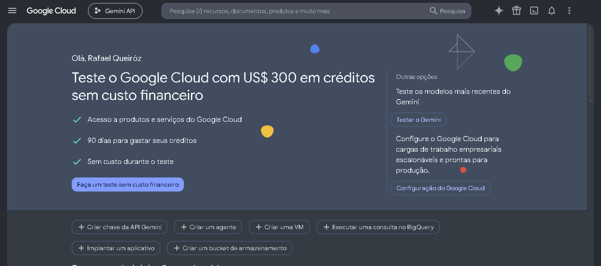

2.  Clique no menu do **Google Cloud**, no canto superior direito da tela

3.  Clique na opção **APIs e serviços → Biblioteca**,

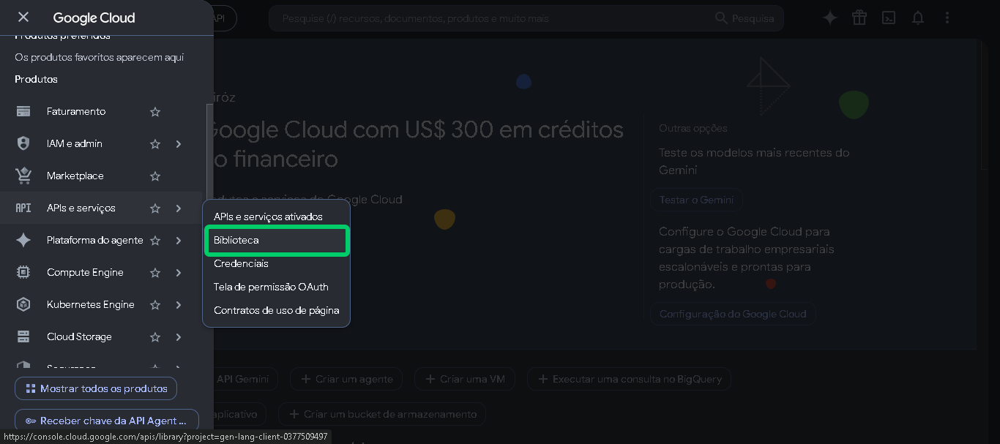

4.  Localize o **Google Sheets API** e clique sobre ela para acessar

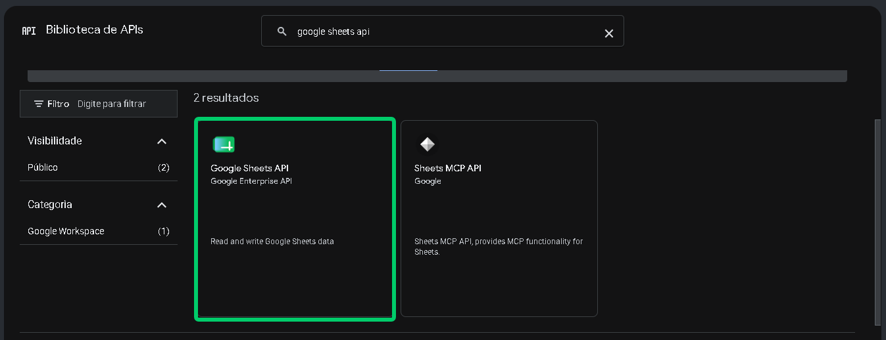

5.  Ative o **Google Sheets API** clicando no botão **Ativar**

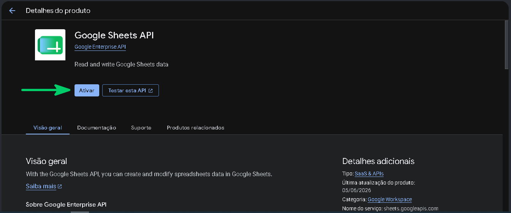

6.  **Repita os passos 2 a 5** e ative o **Google Drive API**.

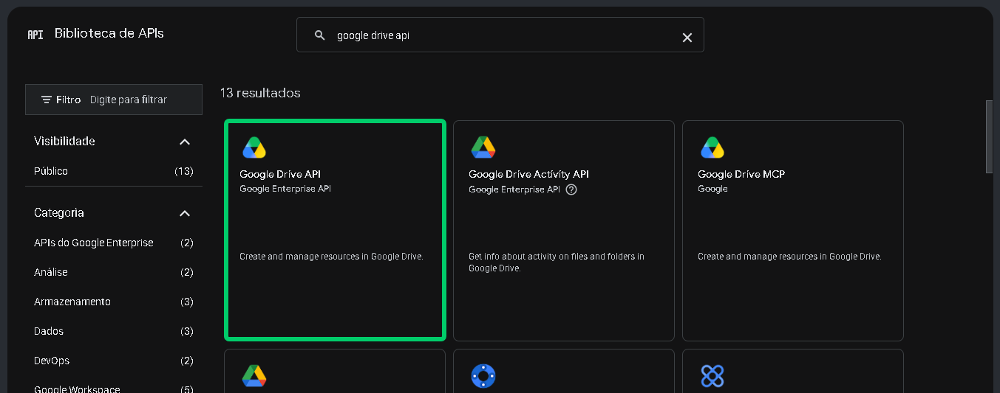

> **Google Sheets API**
>
> A **Google Sheets API** permite que aplicações **acessem e manipulem planilhas do Google Sheets por meio de código**. É possível ler, inserir, atualizar e excluir dados, além de criar e formatar planilhas.
>
> **Exemplo:** uma aplicação pode registrar automaticamente em uma planilha os dados enviados por um formulário.
>
> **Google Drive API**
>
> A **Google Drive API** permite que aplicações **acessem e gerenciem arquivos armazenados no Google Drive por meio de código**. É possível criar, enviar, baixar, mover, compartilhar e excluir arquivos e pastas, conforme as permissões concedidas.
>
> **Exemplo:** uma aplicação pode criar uma pasta no Drive e enviar automaticamente arquivos gerados pelo sistema.

7.  No menu do **Google Cloud**, clique em **IAM e admin → Contas de serviço**

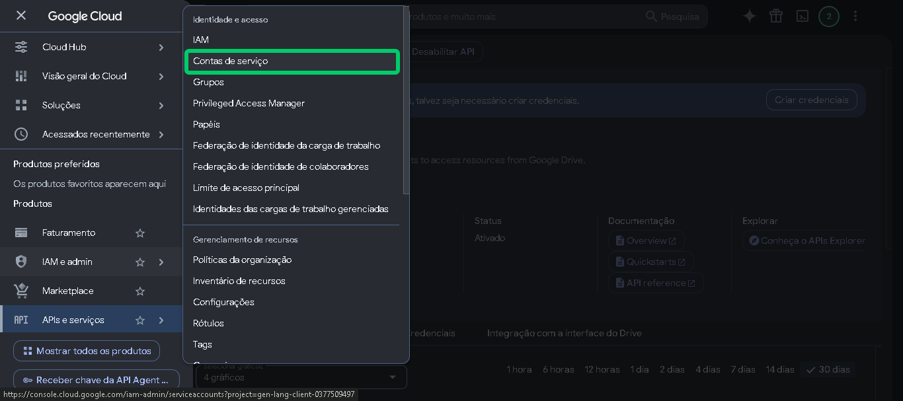

8.  Clique em **+ Criar conta de serviço**

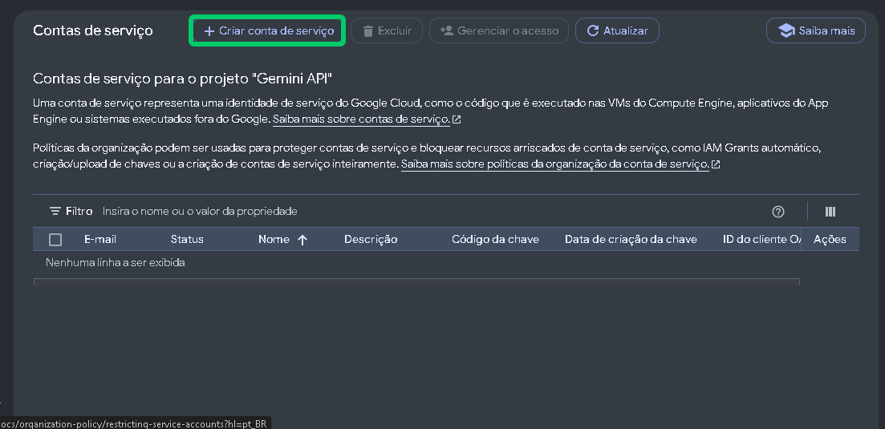

9.  Na propriedade **Nome de exibição para esta conta de serviço**, digite ***desafio1-python*** e conclua sem papéis adicionais, clicando no botão **Criar e fechar**

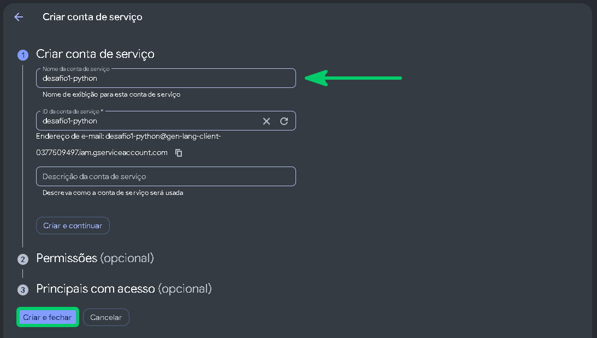

10. Abra a conta criada, clicando sobre ela

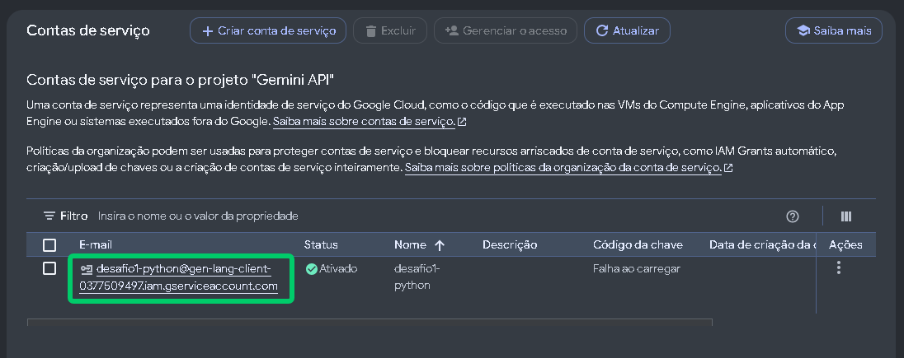

11. Acesse a guia **Chaves**

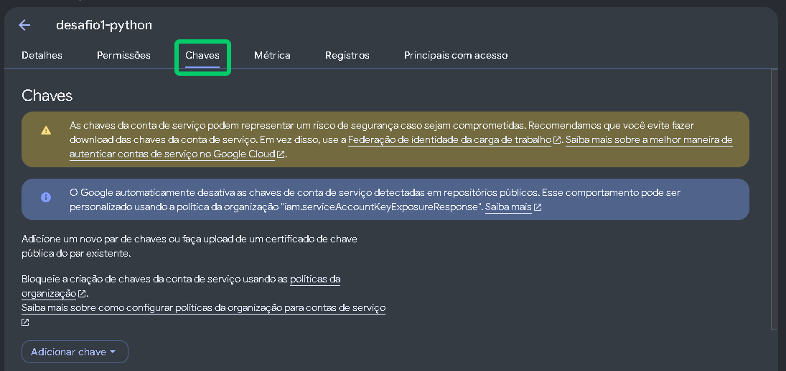

12. Clique no botão **Adicionar chave → Criar nova chave** 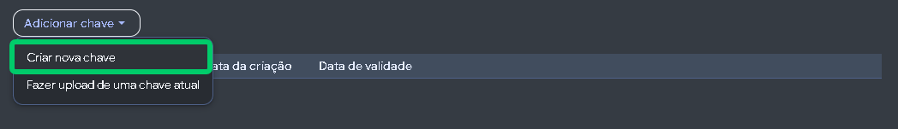

13. Selecione a opção **JSON** e clique no botão **Criar**.

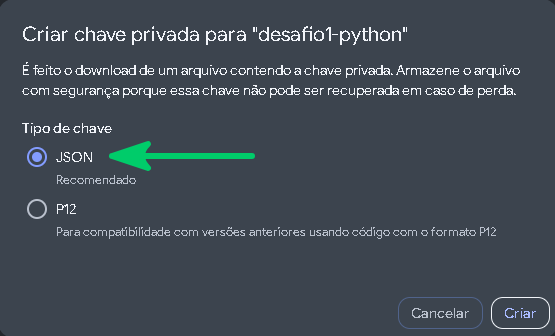

14. O arquivo será baixado no seu computador. Clique no botão **Fechar**

15. Abra o arquivo **JSON** com o Bloco de Notas ou com o Visual Studio Code e copie o valor do atributo ***client_email*** (termina em **iam.gserviceaccount.com**). É para esse e-mail que você vai compartilhar a planilha no passo 5.

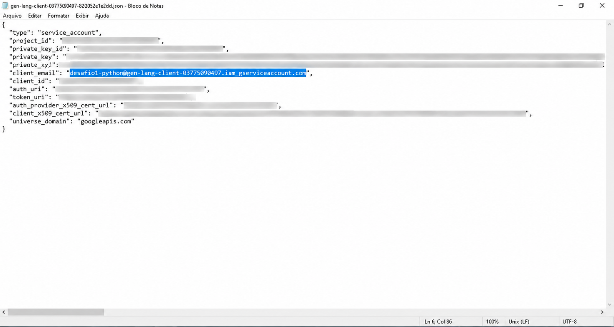

> **O arquivo JSON funciona como uma senha**
>
> **Não publique, não envie por chat e não suba para repositórios**. Quem tiver o arquivo acessa tudo o que a credencial acessa. Se a sua conta de organização bloquear a criação de chaves, peça ajuda ao instrutor.

# Etapa 1 — Conteúdo da sessão

Os três passos a seguir correspondem aos conteúdos, que foram trabalhando na sessão.

## Passo 2 — Entender o que é uma API

Nesta sessão, estudamos o que é uma API e como o Python conversa com o Google Sheets.

**🔑Pontos Chave**

- **API (Interface de Programação de Aplicações)** é um contrato entre dois sistemas: você pede algo num formato combinado e recebe a resposta no mesmo formato, sem precisar saber o que acontece por dentro. É a porta de entrada, não a casa inteira.

- A **Google Sheets API** é a porta que o Python usa para ler e escrever numa planilha do Google.

- A API exige **autenticação**: uma credencial que prova quem está pedindo o acesso. A planilha precisa ser compartilhada com ela; sem compartilhar, a escrita falha em silêncio.

- **Apps Script** roda dentro do Google, em JavaScript. O seu script **Python** roda fora, no Colab, e conversa com a planilha pela API. São ferramentas diferentes que se falam pela API. Não cole código Python no editor do Apps Script: não funciona.

- Bibliotecas como **gspread** ou **google-api-python-client** encapsulam a comunicação, para você não montar a chamada HTTP à mão.

- Cada linha escrita pela API é uma linha real, visível na hora, como se alguém tivesse digitado.

- Erros de permissão são o problema mais comum. Leia o erro retornado: quase sempre ele indica a causa.

- Toda Requisição enviada para uma API, sempre receberá um HTTP Status Code, indicando o sucesso ou o insucesso da Requisição. Consulte o **Anexo I – Principais HTTP Status Code**.

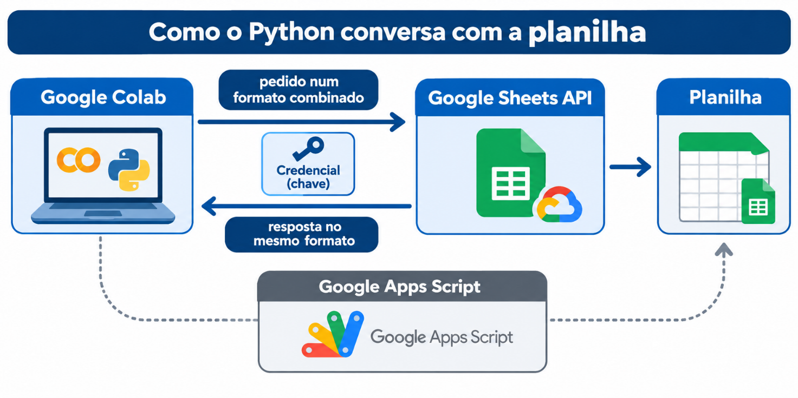

##  Passo 3 — Escolher o tema e ler o esquema de dados

O tema que você escolher hoje acompanha você até o fim do bootcamp: ele volta nos desafios de **Estatística, Excel, SQL e Big Data**. Escolha pensando em curiosidade real, não só no tema mais fácil.

| **\#** | **Tema**               | **O que representa**                       |
|--------|------------------------|--------------------------------------------|
| 1      | Estacionamento         | Vagas e movimentação de veículos           |
| 2      | Posto de Saúde         | Triagem de pacientes (dado 100% fictícios) |
| 3      | Streaming de filmes    | Catálogo e visualizações                   |
| 4      | Atendimento ao cliente | Chamados e satisfação                      |
| 5      | Passagens aéreas       | Voos e reservas                            |
| 6      | Serviço meteorológico  | Estações e leituras                        |
| 7      | Telemetria esportiva   | Pilotos e voltas de corrida                |
| 8      | Festival de música     | Atrações e ingressos vendidos              |

Por que a escolha pesa:

- Trocar de tema no meio do caminho custa retrabalho em tudo que já foi construído.

- Cada tema já tem um **plano de esquema pronto**: nomes de coluna, tipos de tabela e volumetria mínima de **20.000 linhas somadas**.

- Usar o esquema não é limitação, é consistência: os próximos desafios dependem do **nome exato** de cada coluna, e um nome errado gera erro adiante.

> **Repositório base do Desafio**
>
> O repositório que contém todos os detalhes das bases de dados, está disponível [**clicando aqui**](https://github.com/rafaelq80/desafios_tecnicos_ad).

## Passo 4 — IA responsável na geração de dados

A IA pode ajudar a gerar nomes fictícios, textos de exemplo e sugestões de distribuição. **A IA acelera, você verifica.**

- Usar IA para sugerir nomes fictícios, categorias e textos de exemplo é uma boa prática.

- **Nunca** aceite de uma IA um número ou estatística apresentado como fato real sem verificar a fonte.

- **Nunca** peça dado pessoal de alguém real, nem como exemplo. Dado mockado não pode ser nem parecer dado pessoal de ninguém: colega, família ou outra pessoa.

- **Registre**, mesmo que informalmente, quando um trecho foi gerado com apoio de IA.

- Revise sempre se o dado gerado respeita o esquema de colunas do tema.

Para gerar grandes volumes de dados, prefira a Biblioteca **Faker** (Python) à IA generativa:

| **Situação**                                                   | **Ferramenta** | **Por quê**                                       |
|----------------------------------------------------------------|----------------|---------------------------------------------------|
| Muitas linhas repetitivas (centenas ou milhares)               | Faker (Python) | Rápido e sem risco de alucinação em grande volume |
| Casos pontuais: nomes fictícios, categorias, textos de exemplo | IA generativa  | Boa para variedade, mas você verifica o resultado |

Combine as duas conforme a necessidade. Exemplo de pedido que deixa claro que o dado é fictício:

> **Exemplo de prompt**
>
> “Gere 10 nomes **claramente inventados**, sem usar nomes de pessoas reais ou conhecidas, no formato do meu esquema de colunas. Não invente estatísticas.”

---

| Inicio | [README](README.md) | [Avancar → Parte 2](Guia_Desafio1_Google_Colab_Parte2.md) |
|---|---|---|
