# Guia do Projeto 01 · Analista de Dados

**Parte 2 de 3 — Prática na sessão**

| [← Parte 1](Guia_Desafio1_Google_Colab.md) | [README](README.md) | [Avançar → Parte 3](Guia_Desafio1_Google_Colab_Parte3.md) |
|---|---|---|

---

# Etapa 2 — Prática na sessão

Objetivo: Garantir a **conexão funcional com a planilha** e registrar **pelo menos uma linha de dados reais** nela. O tema da planilha já deve estar definido antes de iniciar a atividade.

## Passo 5 — Criar a planilha e compartilhar com a credencial

1.  Acesse [**sheets.new**](https://sheets.new) com sua conta Google e dê um nome à planilha, conforme a tabela abaixo:

| **\#** | **Tema**               | **Nome da Planilha**            |
|--------|------------------------|---------------------------------|
| 1      | Estacionamento         | Desafio_01_Estacionamento       |
| 2      | Posto de Saúde         | Desafio_01_Posto_Saude          |
| 3      | Streaming de filmes    | Desafio_01_Streaming_Filmes     |
| 4      | Atendimento ao cliente | Desafio_01_Atendimento_Cliente  |
| 5      | Passagens aéreas       | Desafio_01_Passagens_Aereas     |
| 6      | Serviço meteorológico  | Desafio_01_Meteorologia         |
| 7      | Telemetria esportiva   | Desafio_01_Telemetria_Esportiva |
| 8      | Festival de música     | Desafio_01_Festival_Musica      |

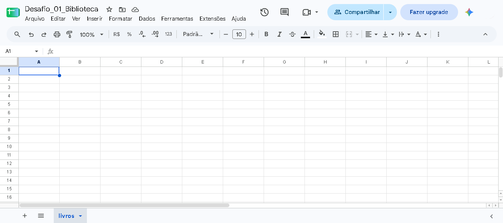

> **Biblioteca Pública não é um tema**
>
> A imagem acima com o tema **Biblioteca Pública**, foi criada apenas para ilustrar a tarefa, desenvolvido de forma semelhante aos 8 temas propostos.

2.  Clique em **Compartilhar**, cole o client_email copiado no passo 1, defina o papel como **Editor**, desmarque a opção **notificar pessoas** e clique no botão **Compartilhar**.

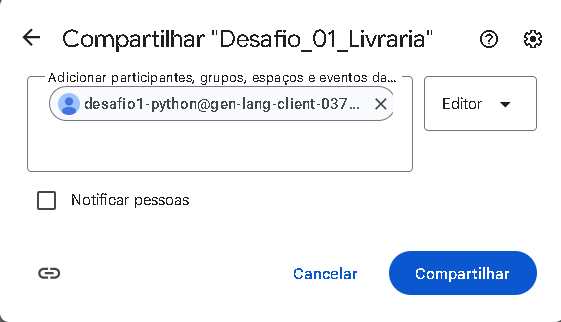

3.  Copie o **ID da planilha** na barra de endereços: é o trecho do link da planilha entre /d/ e /edit.

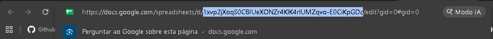

> **Sem compartilhar, a escrita falha em silêncio**
>
> Confira que o e-mail da credencial aparece na lista de pessoas com acesso. Esse é o obstáculo mais comum da prática.

## Passo 6 — Abrir o Colab e autenticar

1.  Acesse [**colab.research.google.com**](https://colab.research.google.com) e crie um notebook novo (Arquivo → Novo notebook).

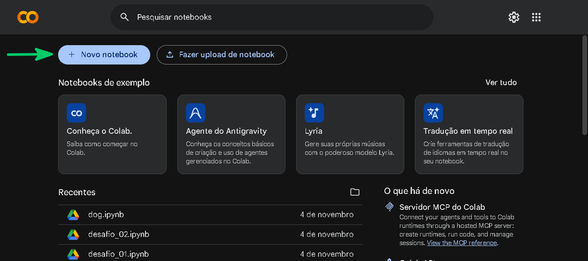

2.  Renomeie para Desafio1_API_Python.

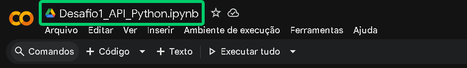

3.  No painel esquerdo do Google Colab, abra o ícone de chave (**Secrets**) **→ Adicionar novo secret**.

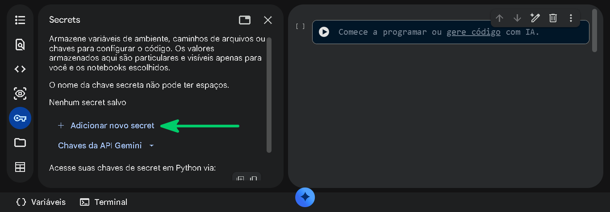

4.  **Nome:** GCP_SA_JSON. **Valor:** o **conteúdo inteiro** do arquivo JSON (selecione todo o conteúdo do arquivo, copie e cole). Ao concluir, feche este painel, clicando no **X**

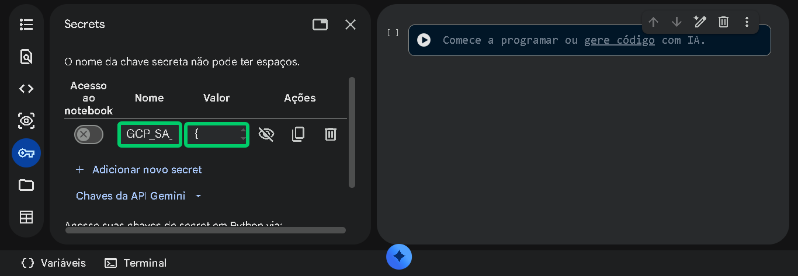

5.  Cole as células abaixo, uma por célula, e execute uma a uma (Shift + Enter).

**Célula 01 · Instalar**

``` python
# Instala as bibliotecas usadas no guia.
!pip install -q gspread faker
```

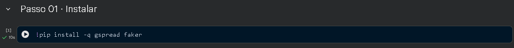

**Célula 02 · Importações e Autenticação (service account)**

``` python
# Importa as ferramentas para autenticação, geração de dados e sorteios.
import json, gspread
from google.colab import userdata
from faker import Faker
import random
 
# Lê a credencial salva nos Secrets e conecta à planilha.
info = json.loads(userdata.get("GCP_SA_JSON"))
gc = gspread.service_account_from_dict(info)
# Exibe o e-mail da conta autenticada.
print("Conectado como:", info["client_email"])
```

1.  Ao executar esta célula pela primeira vez, será necessário autorizar o notebook a acessar a secret **GCP_SA_JSON**N, como vemos na imagem abaixo. Clique no botão **Permitir acesso**

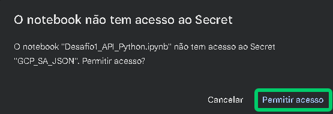

2.  Execute novamente a célula 2 e verifique se a conexão foi bem-sucedida (será exibido o **client_email**)

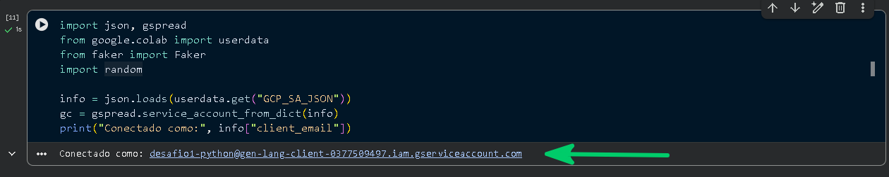

**Célula 03 · Abrir a planilha**

``` python
# Informe o ID da planilha e o nome que será dado à aba.
SHEET_ID = "COLE_AQUI_O_ID_DA_PLANILHA"
NOME_TABELA = "nome_da_tabela"   # nome da tabela na ficha do tema, ex.: "vagas"
 
# Abre a planilha e seleciona sua primeira aba.
sh = gc.open_by_key(SHEET_ID)
ws = sh.sheet1
# Renomeia a aba e exibe os dados da planilha.
ws.update_title(NOME_TABELA)     # a aba passa a ter o nome da tabela
print(sh.title, "|", ws.title, "|", sh.url)
```

1.  Não esqueça de inserir o ID da Planilha na constante **SHEET_ID**

2.  Na constante **NOME_TABELA**, adicione o nome da tabela dimensão do seu projeto, conforme a tabela abaixo:

| \#  | Tema                   | Pasta                     | Dimensão  | Fato               |
|-----|------------------------|---------------------------|-----------|--------------------|
| 1   | Estacionamento         | 01-estacionamento         | vagas     | movimentacoes      |
| 2   | Posto de saúde         | 02-posto-de-saude         | pacientes | atendimentos       |
| 3   | Streaming de filmes    | 03-streaming-de-filmes    | filmes    | visualizacoes      |
| 4   | Atendimento ao cliente | 04-atendimento-ao-cliente | clientes  | chamados           |
| 5   | Passagens aéreas       | 05-passagens-aereas       | voos      | reservas           |
| 6   | Serviço meteorológico  | 06-servico-meteorologico  | estacoes  | leituras           |
| 7   | Telemetria esportiva   | 07-telemetria-esportiva   | pilotos   | voltas             |
| 8   | Festival de música     | 08-festival-de-musica     | atracoes  | ingressos_vendidos |

3.  Se aparecer o título da sua planilha, a autenticação funcionou.

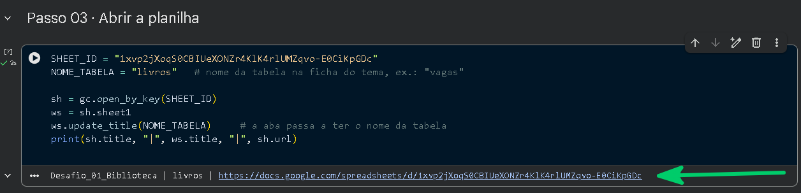

4.  Observe que o nome da planilha no Google Sheets também foi modificado:

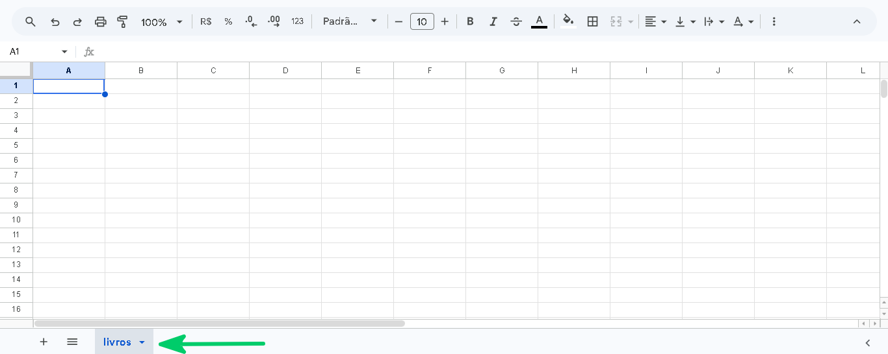

## Passo 7 — Escrever o cabeçalho do esquema

Defina a lista de colunas **uma única vez** e reutilize-a em todo o código. Os nomes vêm da ficha do tema, **sem nenhuma alteração**. Todos os temas possuem duas tabelas, logo vamos começar pela tabela **dimensão.** A tabela fato, será criada na Parte 2.

**Célula 04 · Cabeçalho – Tabela Dimensão**

``` python
# Substitua pelos nomes EXATOS de coluna da ficha do seu tema
# Define as colunas que formarão o cabeçalho da tabela.
COLUNAS = ["coluna_1", "coluna_2", "coluna_3"]
 
# Escreve o cabeçalho na primeira célula e confere o resultado.
ws.update(range_name="A1", values=[COLUNAS])
print("Cabeçalho confere:", ws.row_values(1) == COLUNAS)
```

> **O esquema é fixo**
>
> Usar o nome errado de coluna (por exemplo, duracao_minutos no lugar de duracao_min) é um erro sutil: só aparece quando alguém compara com atenção o que o plano define com o que o código escreve. Rodar o script e assumir que funcionou não basta.

1.  Observe na planilha que a primeira linha foi preenchida com os nomes dos atributos da tabela dimensão

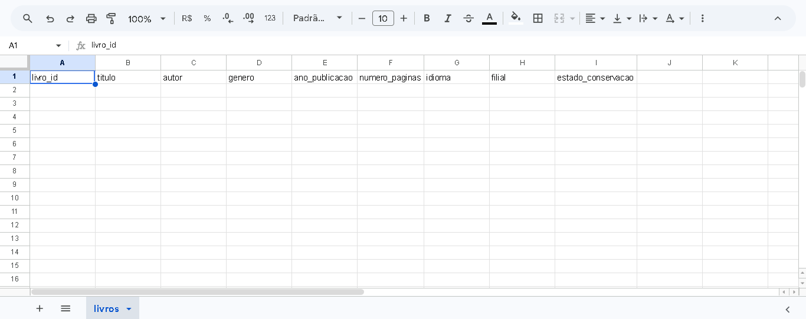

## Passo 8 — Gerar e escrever 10 linhas de teste

Gere 10 linhas de dado mockado seguindo o esquema do tema. Lembre-se das regras do passo 4: dado **fictício**, nada que lembre uma pessoa real e registro de qualquer trecho gerado com IA.

**Célula 05 · 10 linhas de teste – Tabela Dimensão**

``` python
# Configura os geradores aleatórios para produzir resultados reproduzíveis.
fake = Faker("pt_BR")
Faker.seed(42)
random.seed(42)
 
def gerar_linha(i):
    # Cria um registro fictício para as colunas definidas no esquema.
    # Personalize de acordo com o seu esquema de dados
    return {
        "coluna_1": i,
        "coluna_2": random.choice(["A", "B", "C"]),
        "coluna_3": fake.date_this_year().isoformat(),   # datas como texto
    }
 
# Gera 10 registros numerados de 1 a 10.
linhas = [gerar_linha(i) for i in range(1, 11)]
 
# Organiza os valores na ordem do cabeçalho; nome de coluna incorreto gera KeyError.
valores = [[linha[c] for c in COLUNAS] for linha in linhas]
# Acrescenta os registros à planilha e informa quantos foram enviados.
ws.append_rows(valores, value_input_option="RAW")
print(len(valores), "linhas enviadas")
```

Ajuste gerar_linha para devolver exatamente as colunas e os tipos do seu tema. A estrutura \[linha\[c\] for c in COLUNAS\] acusa na hora um nome de coluna diferente do esquema.

1.  Observe na planilha que da linha 2 até a linha 11, foram preenchidas com dados gerados pela biblioteca Faker

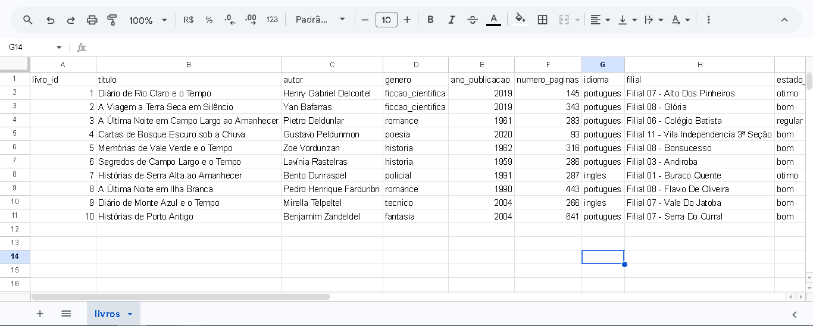

## Passo 9 — Conferir o resultado na planilha

Executar sem erro prova que o código rodou, não que o dado chegou. **Leia de volta** o que está na planilha:

**CÉLULA 6 · Conferência – Tabela Dimensão**

``` python
# Lê todos os valores da aba para conferir o conteúdo enviado.
valores_lidos = ws.get_all_values()
# Exibe a quantidade de linhas, confere o cabeçalho e mostra exemplos.
print("Linhas (cabeçalho + dados):", len(valores_lidos))    # esperado: 11
print("Cabeçalho confere:", valores_lidos[0] == COLUNAS)
print(valores_lidos[:3])
```

Depois **abra a planilha no navegador** e confirme visualmente: cabeçalho na linha 1, 10 linhas de dados abaixo, colunas com os nomes certos e nenhum dado que lembre uma pessoa real. Ao final, mostre a planilha ao instrutor.

> **PARE AQUI NA SESSÃO**
>
> Se a sua planilha mostra o cabeçalho e as 10 linhas, você cumpriu a meta da sessão. Os passos seguintes são trabalho autônomo.

---

| [← Parte 1](Guia_Desafio1_Google_Colab.md) | [README](README.md) | [Avancar → Parte 3](Guia_Desafio1_Google_Colab_Parte3.md) |
|---|---|---|
