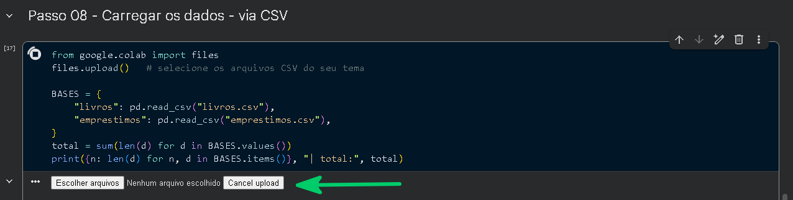
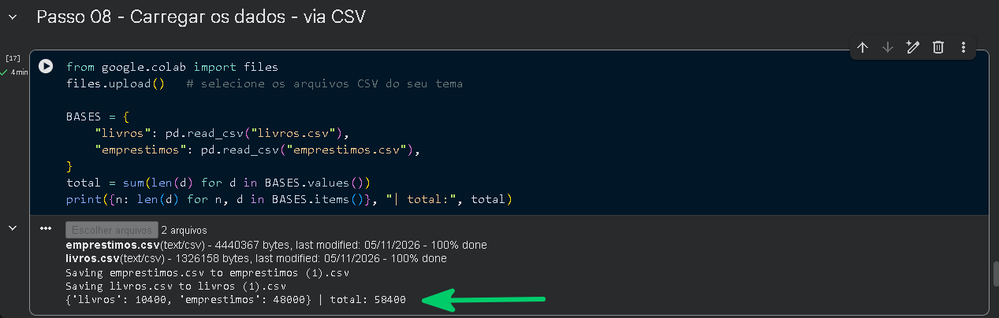
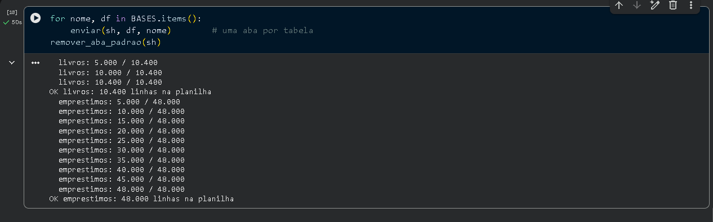
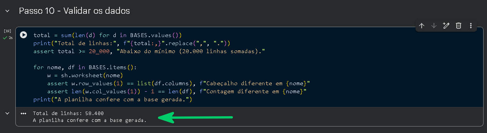
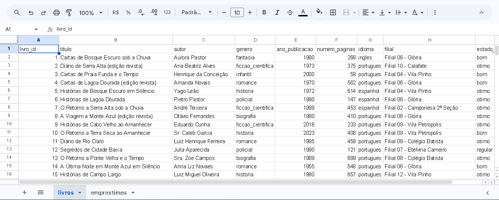

# Guia do Projeto 01 · Analista de Dados

**Parte 3 de 3 — Depois da sessão e referências**

| [← Parte 2](Guia_Desafio1_Google_Colab_Parte2.md) | [README](README.md) | Fim do guia |
|---|---|---|

---

# Etapa 3 — Depois da sessão

Agora você constrói a entrega completa: a base inteira do seu tema, com o esquema de colunas da ficha, na Google Sheets. Faça até a **data de entrega da primeira planilha populada**, combinada com o instrutor.

## Passo 10 — Planejar a base completa

- **Volumetria mínima: 20.000 linhas somadas** (todas as tabelas do tema juntas).

- Cada tabela do plano de esquema vai para **uma aba** da planilha, com o nome da tabela.

- Gere primeiro as tabelas de referência (cadastros) e depois as que dependem delas, reaproveitando os IDs. Uma chave estrangeira deve sempre apontar para um ID que existe na outra tabela.

- Use **Faker** para o volume e IA apenas para casos pontuais (passo 4). Dado 100% fictício.

- Os nomes de coluna são os da ficha, sem alteração.

> **Confirme com o instrutor**
>
> Caso o instrutor distribua uma **base pronta** (arquivos CSV do seu tema), use a opção B do passo 11 em vez de gerar os dados você mesmo. Se for gerar, siga a opção A.

## Passo 11 — Gerar ou carregar as tabelas

Volte ao mesmo notebook e continue a partir da **Parte 2**, na célula 7. Primeiro, as funções de envio (reutilizadas nos passos 12 e 13):

**CÉLULA 7 · Funções de envio de dados - Planilha**

``` python
# Importa recursos para controlar pausas, acessar a planilha e tratar tabelas.
import time
import gspread
import pandas as pd
 
def df_para_valores(df):
    """DataFrame -> lista de listas com tipos nativos do Python."""
    # Trabalha em uma cópia para não alterar o DataFrame original.
    df = df.copy()
    for c in df.columns:
        # Converte datas para texto em um formato padronizado.
        if pd.api.types.is_datetime64_any_dtype(df[c]):
            df[c] = df[c].dt.strftime("%Y-%m-%d %H:%M:%S")
        # Converte outros valores de data e hora para texto.
        elif df[c].dtype == object:
            df[c] = df[c].map(
                lambda v: v.isoformat() if hasattr(v, "isoformat") else v)
    # Substitui valores ausentes por texto vazio e retorna linhas de valores.
    return df.astype(object).where(df.notna(), "").values.tolist()
 
def enviar(sh, df, nome_aba, lote=5000, pausa=2):
    """Escreve cabeçalho e linhas numa aba, em lotes, e confere a contagem."""
    # Formata números com ponto como separador de milhar.
    n = lambda x: f"{x:,}".replace(",", ".")
    try:
        # Reutiliza a aba existente e apaga seu conteúdo anterior.
        ws = sh.worksheet(nome_aba)
        ws.clear()
    except gspread.WorksheetNotFound:
        # Cria uma aba caso ela ainda não exista.
        ws = sh.add_worksheet(title=nome_aba, rows=len(df) + 1,
                              cols=len(df.columns))
    # Ajusta o tamanho da aba e grava os nomes das colunas.
    ws.resize(rows=len(df) + 1, cols=len(df.columns))
    ws.update(range_name="A1", values=[list(df.columns)])
    # Converte o DataFrame e envia as linhas em lotes.
    valores = df_para_valores(df)
    for i in range(0, len(valores), lote):
        ws.append_rows(valores[i:i + lote], value_input_option="RAW")
        print(f"  {nome_aba}: {n(min(i + lote, len(valores)))} / {n(len(valores))}")
        time.sleep(pausa)               # respeita o limite de escritas/minuto
    # Confere se a quantidade de linhas gravadas corresponde à esperada.
    lidas = len(ws.col_values(1)) - 1   # lê de volta e confere
    if lidas != len(df):
        raise RuntimeError(f"Aba {nome_aba}: enviei {len(df)}, li {lidas}.")
    print(f"OK {nome_aba}: {n(len(df))} linhas na planilha")
 
def remover_aba_padrao(sh):
    """Apaga a aba vazia que o Google cria junto com a planilha nova."""
    # Localiza e remove a aba padrão somente se houver outra aba disponível.
    abas = sh.worksheets()
    padrao = ("Página1", "Sheet1", "Planilha1")
    for w in abas:
        if w.title in padrao and len(abas) > 1 and not w.get_all_values():
            sh.del_worksheet(w)
```

Depois, escolha **uma** das duas opções para montar o dicionário BASES (uma entrada por tabela, com o nome da tabela como chave).

### Opção A — Carregar a base pronta fornecida pelo instrutor

**CÉLULA 8 · Carregar Bases de dados - Prontas**

``` python
# Abre a opção de selecionar arquivos CSV no Colab e envia os arquivos.
from google.colab import files
files.upload()   # selecione os arquivos CSV do seu tema
 
# Carrega cada CSV em um DataFrame e associa-o ao nome da tabela.
# Altere o nome da tabela de acordo com a sua Base de dados
BASES = {
    "nome_tabela_1": pd.read_csv("nome_tabela_1.csv"),
    "nome_tabela_2": pd.read_csv("nome_tabela_2.csv"),
}
# Calcula e exibe a quantidade de linhas carregadas.
total = sum(len(d) for d in BASES.values())
print({n: len(d) for n, d in BASES.items()}, "| total:", total)
```

1.  Não esqueça de substituir nome_tabela_1.csv e nome_tabela_2.csv, pelos respectivos nomes dos arquivos da sua base de dados, conforme tabela abaixo:

| \#  | Base (pasta)              | CSV da dimensão | CSV do fato            |
|-----|---------------------------|-----------------|------------------------|
| 1   | 01-estacionamento         | vagas.csv       | movimentacoes.csv      |
| 2   | 02-posto-de-saude         | pacientes.csv   | atendimentos.csv       |
| 3   | 03-streaming-de-filmes    | filmes.csv      | visualizacoes.csv      |
| 4   | 04-atendimento-ao-cliente | clientes.csv    | chamados.csv           |
| 5   | 05-passagens-aereas       | voos.csv        | reservas.csv           |
| 6   | 06-servico-meteorologico  | estacoes.csv    | leituras.csv           |
| 7   | 07-telemetria-esportiva   | pilotos.csv     | voltas.csv             |
| 8   | 08-festival-de-musica     | atracoes.csv    | ingressos_vendidos.csv |

2.  O Notebook irá solicitar que você faça o upload do arquivo



3.  Selecione os 2 arquivos CSV da sua base de dados conforme a tabela acima e aguarde a conclusão do upload



### Opção B — Gerar as tabelas com Faker e numpy

**CÉLULA 8 · Gerar Bases de Dados**

``` python
# Importa ferramentas para criar tabelas e gerar dados fictícios.
import numpy as np
from faker import Faker
 
# Define geradores aleatórios reproduzíveis.
rng = np.random.default_rng(42)
fake = Faker("pt_BR")
Faker.seed(42)
 
# ---- Tabela 1 (de referência) ----
# Define a quantidade de registros da tabela de referência.
N1 = 10_000
# Cria IDs sequenciais e escolhe valores fictícios para as demais colunas.
tabela_1 = pd.DataFrame({
    "coluna_1": np.arange(1, N1 + 1),
    "coluna_2": rng.choice(["A", "B", "C"], size=N1, p=[0.5, 0.3, 0.2]),
    # ... uma entrada para CADA coluna da ficha ...
})
 
# ---- Tabela 2 (usa os IDs da tabela 1) ----
# Define a quantidade de registros da tabela que referencia a primeira.
N2 = 20_000
# Cria IDs e escolhe, para cada linha, um ID existente na tabela 1.
tabela_2 = pd.DataFrame({
    "coluna_1": np.arange(1, N2 + 1),
    "coluna_2": rng.integers(1, N1 + 1, size=N2),   # FK: ID da tabela 1
    # ...
})
 
# Guarda as tabelas e a ordem esperada de suas colunas.
BASES = {"nome_tabela_1": tabela_1, "nome_tabela_2": tabela_2}
COLUNAS_FICHA = {
    "nome_tabela_1": ["coluna_1", "coluna_2"],       # copie da ficha, na mesma ordem
    "nome_tabela_2": ["coluna_1", "coluna_2"],
}
# Confere se as colunas de cada tabela seguem o esquema da ficha.
for nome, df in BASES.items():
    assert list(df.columns) == COLUNAS_FICHA[nome], f"Colunas erradas em {nome}"
# Calcula e exibe a quantidade total de registros gerados.
total = sum(len(d) for d in BASES.values())
print({n: len(d) for n, d in BASES.items()}, "| total:", total)
```

- Nas colunas da tabela 1, utilize a mesma configuração do teste. Na tabela 2, ajuste conforme a documentação da sua base de dados

- Para nomes fictícios use \[fake.name() for \_ in range(N)\];

- Para cidades, fake.city().

- Confira se algum nome gerado coincide com alguém que você conhece.

- No tema Posto de Saúde, prefira códigos (por exemplo, PAC-0001) a nomes.

## Passo 12 — Enviar para a planilha em lotes

A API limita o número de escritas por minuto. Por isso o envio é feito em **lotes de 5.000 linhas** com uma pausa de 2 segundos entre eles. Os números são gravados como números e as datas como texto no formato AAAA-MM-DD.

**CÉLULA 9 · Enviar**

``` python
# Envia cada tabela para uma aba e remove a aba padrão, se estiver vazia.
for nome, df in BASES.items():
    enviar(sh, df, nome)        # uma aba por tabela
remover_aba_padrao(sh)
```

As 10 linhas de teste da sessão são substituídas: a função limpa a aba e reescreve cabeçalho e dados. Pode executar de novo sem duplicar linhas.

1.  Observe que os dados são enviados em lotes de 5000 linhas



## Passo 13 — Validar a base na planilha

**CÉLULA 10 · Validar**

``` python
# Soma e exibe a quantidade total de linhas das tabelas.
total = sum(len(d) for d in BASES.values())
print("Total de linhas:", f"{total:,}".replace(",", "."))
# Interrompe a execução se o volume mínimo não for atingido.
assert total >= 20_000, "Abaixo do mínimo (20.000 linhas somadas)."
 
# Confere os cabeçalhos e a quantidade de registros em cada aba.
for nome, df in BASES.items():
    w = sh.worksheet(nome)
    assert w.row_values(1) == list(df.columns), f"Cabeçalho diferente em {nome}"
    assert len(w.col_values(1)) - 1 == len(df), f"Contagem diferente em {nome}"
# Confirma que todas as verificações passaram.
print("A planilha confere com a base gerada.")
```

1.  Observe que os dados foram validados.



Depois da conferência no código, **abra a planilha** e verifique à mão:

- Uma aba por tabela, com o nome da tabela.

- Cabeçalho na linha 1 igual ao da ficha, sem nome de coluna alterado.

- A última linha de cada aba tem o número esperado de registros.

- Nenhum dado é nem parece dado pessoal real de alguém.



# Quando algo não funciona

Um script correto pode rodar sem erro e a planilha continuar vazia. A ausência de erro mostra apenas que o código executou, não que a operação funcionou. O passo que evita a dúvida é sempre o mesmo: **ler de volta da planilha** e comparar com o que você enviou.

### Planilha não atualiza, e não há mensagem de erro

| **Causa provável**                                        | **Como verificar**                                                              |
|-----------------------------------------------------------|---------------------------------------------------------------------------------|
| Planilha não compartilhada com o client_email             | Compartilhar → conferir a lista de pessoas; o papel deve ser Editor             |
| Script escreve em outra planilha ou outra aba             | print(sh.title, ws.title, sh.url) e abrir o link impresso                       |
| Célula de escrita não foi executada, ou foi fora de ordem | Executar o notebook de cima para baixo e conferir a contagem de linhas enviadas |
| try/except que esconde o erro                             | Remover o except genérico ou imprimir a exceção                                 |
| Olhando a planilha ou a conta Google errada               | Abrir sh.url na mesma conta usada no passo 5                                    |

### Mensagens de erro mais comuns

| **Mensagem**                                   | **Causa**                                   | **Correção**                                                     |
|------------------------------------------------|---------------------------------------------|------------------------------------------------------------------|
| APIError ... 403 ... PERMISSION_DENIED         | Planilha não compartilhada com a credencial | Compartilhar com o client_email como Editor                      |
| Google Sheets API has not been used in project | API não ativada                             | Ativar a Sheets API no projeto (passo 1)                         |
| SpreadsheetNotFound                            | ID errado ou sem acesso                     | Recopiar o ID da URL e rever o compartilhamento                  |
| KeyError: 'nome_da_coluna'                     | Nome diferente do esquema                   | Corrigir gerar_linha para usar os nomes de COLUNAS               |
| APIError ... 429 ... Quota exceeded            | Muitas escritas por minuto                  | Esperar um minuto, reduzir o tamanho do lote ou aumentar a pausa |
| Código Python colado no Apps Script não roda   | Python não executa no Apps Script           | Rodar o código no Colab                                          |

# Termos principais

| **Termo**         | **Significado**                                                                            |
|-------------------|--------------------------------------------------------------------------------------------|
| API               | Interface de Programação de Aplicações: a forma como um programa pede algo a outro sistema |
| Autenticação      | A chave de acesso (credencial) que prova quem está pedindo acesso a um serviço             |
| Google Sheets API | A porta de entrada que o Python usa para ler e escrever numa planilha do Google            |
| Apps Script       | Código do Google em JavaScript que roda dentro do Google (não é Python)                    |
| Dado mockado      | Dado fictício, gerado para treino                                                          |
| Esquema de dados  | Os nomes e tipos das colunas de uma tabela                                                 |
| IA responsável    | Usar IA sem apresentar o resultado como fato verificado                                    |

# ANEXO I – Principais HTTP Status Code

**Sucesso**

| Código | Nome       | Descrição / Uso                                                                                    |
|--------|------------|----------------------------------------------------------------------------------------------------|
| 200    | OK         | Requisição bem-sucedida. Padrão para respostas GET, PUT ou PATCH que retornam dados.               |
| 201    | Created    | Recurso criado com sucesso. Muito comum após uma requisição POST.                                  |
| 204    | No Content | Requisição processada com sucesso, mas sem conteúdo no corpo da resposta (ex: remoção via DELETE). |

**Erro do Cliente**

| Código | Nome         | Descrição / Uso                                                                        |
|--------|--------------|----------------------------------------------------------------------------------------|
| 400    | Bad Request  | A requisição está malformada ou contém dados inválidos de validação.                   |
| 401    | Unauthorized | O cliente precisa se autenticar para obter a resposta (ausência de token/credenciais). |
| 403    | Forbidden    | O cliente está autenticado, mas não possui permissão para acessar o recurso.           |
| 404    | Not Found    | O recurso solicitado não foi encontrado no servidor.                                   |

**Erro do Servidor**

| Código | Nome                  | Descrição / Uso                                                     |
|--------|-----------------------|---------------------------------------------------------------------|
| 500    | Internal Server Error | Erro genérico no servidor (falha não tratada no código).            |
| 502    | Bad Gateway           | O servidor recebeu uma resposta inválida.                           |
| 503    | Service Unavailable   | O servidor está indisponível no momento (manutenção ou sobrecarga). |
| 504    | Gateway Timeout       | O servidor não recebeu resposta a tempo do servidor backend.        |

---

| [← Parte 2](Guia_Desafio1_Google_Colab_Parte2.md) | [README](README.md) | Fim do guia |
|---|---|---|
