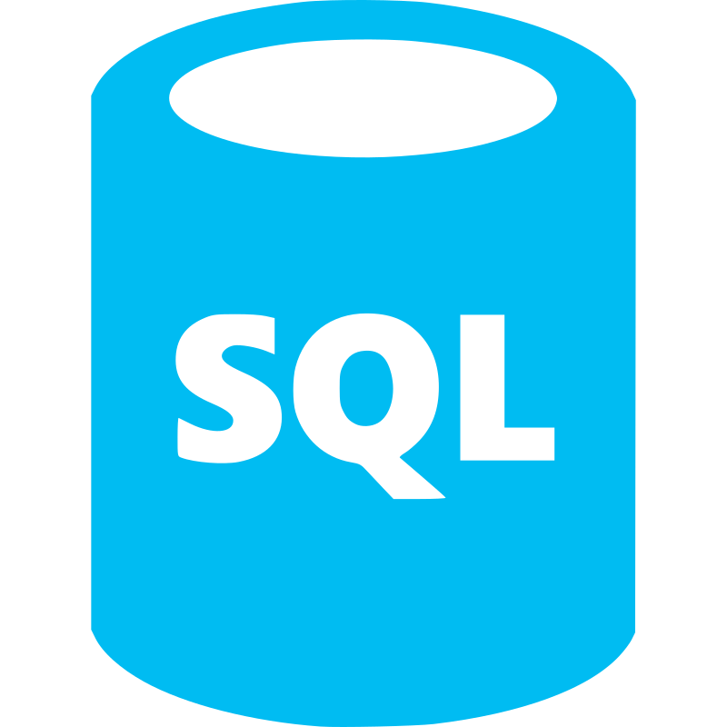

  

  
  
  
  
  
  
  
  

# Desafios Técnicos - Analista de  Dados

**Bem-vindo(a)!** 

Este repositório reúne os **conteúdos dos Desafios Técnicos do Bootcamp Analista de dados**: guias dos desafios, planos de modelagem das bases de dados e as base de dados que serão utilizadas em cada atividade.

---

## O que é

Em vez de cinco exercícios soltos, o bootcamp propõe **um único projeto que evolui ao longo de cinco desafios**. Na primeira etapa, cada participante escolhe um entre 8 temas de dados (veja [Os temas](#os-temas)) e **segue com ele até o fim**. A mesma base é retrabalhada, a cada desafio, com uma ferramenta nova: Python, estatística, Excel, SQL e, por fim, Big Data.

Assim, você pratica o ciclo real de um analista de dados: **coletar, descrever, analisar, modelar, visualizar e pensar em escala**, sempre sobre o mesmo assunto.

> [!WARNING]
>
> Todos os dados são **mockados** (fictícios), gerados para treino. Nenhum dado pessoal real será utilizado.

---

## Os Desafios

Cada desafio tem uma sessão guiada de cerca de 1 hora (abertura, conteúdo, prática e encerramento) e uma entrega construída de forma assíncrona, com **tempo estimado de 150 a 180 minutos (2h30 a 3h)**.

| Desafio | Ferramenta | Tema técnico | O que você faz | Entrega |
|:-------:|:----------:|--------------|----------------|---------|
| 1 |  | Python, API e IA | Escolhe o tema, conecta o Python à Google Sheets API e popula a planilha com dados mockados, seguindo o esquema de colunas do tema e as regras de uso responsável de IA | Planilha Google com cabeçalho e dados do tema |
| 2 |  | Estatística com Python | Carrega a base em um DataFrame pandas, calcula medidas de tendência central e dispersão e transforma os números em insights | Relatório estatístico com recomendação de decisão (gráfico como diferencial) |
| 3 |  | Excel: relatório dinâmico | Constrói um relatório com tabela dinâmica, gráficos e fórmulas obrigatórias (PROCV, SE, SEERRO, SOMASES, CONT.SES, MÉDIASES, entre outras) | Relatório dinâmico em Excel ou Google Sheets |
| 4 |  | SQL e Data Visualization | Evolui a base para um modelo relacional com mais tabelas, escreve consultas com join e subquery, cria views e refaz o relatório com o SQL como fonte | Modelo relacional, consultas e views, e relatório com SQL |
| 5 |  | Big Data com Python | Entende os 5 V's do Big Data e os conceitos básicos de machine learning, e aplica ambos ao tema escolhido | Artigo técnico curto, com argumento e fontes citadas |

### As etapas em resumo

1. **Python, API e IA:** escolha do tema, primeira conexão Python → Google Sheets e geração de dados mockados com IA usada de forma responsável.
2. **Estatística com Python:** da planilha ao pandas, medidas descritivas e a pergunta "e daí?": todo insight precisa de um número por trás.
3. **Excel, relatório dinâmico:** buscar e validar dados, somar e contar por critério, tratar texto e data, e apresentar tudo em um relatório confiável e legível.
4. **SQL e Data Visualization:** do plano ao modelo relacional (cardinalidade, chaves, novas tabelas), consultas, views e um relatório com SQL como fonte principal.
5. **Big Data com Python:** quando o pandas deixa de bastar, diferença entre estatística descritiva e modelo preditivo, e um artigo técnico conectando tudo ao seu tema.

---

## Os Temas

| | # | Tema | Plano | Tabelas (dimensão · fato) | Linhas |
|:-:|:-:|:--|:--|:--|--:|
|  | 1 | Estacionamento | [01-estacionamento.md](bases_dados/01-estacionamento/01-estacionamento.md) | `vagas` · `movimentacoes` | 52.200 |
|  | 2 | Posto de Saúde (triagem) | [02-posto-de-saude.md](bases_dados/02-posto-de-saude/02-posto-de-saude.md) | `pacientes` · `atendimentos` | 52.500 |
|  | 3 | Streaming de filmes | [03-streaming-de-filmes.md](bases_dados/03-streaming-de-filmes/03-streaming-de-filmes.md) | `filmes` · `visualizacoes` | 65.300 |
|  | 4 | Atendimento ao cliente | [04-atendimento-ao-cliente.md](bases_dados/04-atendimento-ao-cliente/04-atendimento-ao-cliente.md) | `clientes` · `chamados` | 52.400 |
|  | 5 | Passagens aéreas | [05-passagens-aereas.md](bases_dados/05-passagens-aereas/05-passagens-aereas.md) | `voos` · `reservas` | 65.600 |
|  | 6 | Serviço meteorológico | [06-servico-meteorologico.md](bases_dados/06-servico-meteorologico/06-servico-meteorologico.md) | `estacoes` · `leituras` | 72.050 |
|  | 7 | Telemetria esportiva | [07-telemetria-esportiva.md](bases_dados/07-telemetria-esportiva/07-telemetria-esportiva.md) | `pilotos` · `voltas` | 65.800 |
|  | 8 | Festival de música | [08-festival-de-musica.md](bases_dados/08-festival-de-musica/08-festival-de-musica.md) | `atracoes` · `ingressos_vendidos` | 65.100 |

> **Como escolher:** o tema vale para o bootcamp inteiro, então prefira o que desperta curiosidade real, e não apenas o que parece mais fácil.

---

## Convenção comum a todos os temas

**Estrutura das tabelas**

- **Todas as Bases de Dados possuem 2 tabelas de tipos diferentes**: uma tabela de **dimensão/cadastro** (a entidade central, com chave primária única) e uma tabela de **fato/evento** (os registros ao longo do tempo, em maior volume, que referencia a dimensão por chave estrangeira).
- **Essa separação é proposital:** prepara o terreno para o Desafio 4, em que serão **adicionadas novas tabelas de dimensão** para transformar o modelo de 2 tabelas em um esquema estrela com mais joins.
- Colunas de tipo e categoria ficam como **texto puro**, de propósito. A normalização delas em catálogos é tarefa do Desafio 4.

**Volumetria**

- Regra do projeto: **mínimo de 20.000 linhas somadas** por tema.
- O script gera **pelo menos 10.000 linhas por tabela** (dimensão e fato), então todos os temas ficam bem acima do mínimo, com entre 52 mil e 72 mil linhas.
- A tabela de fato carrega a maior parte do volume. A dimensão também passa de 10 mil linhas, o que faz com que cada entidade apareça em média de 4 a 6 vezes na tabela de fato.

**Geração**

- As bases de dados foram geradas através de um script Python, utilizando as bibliotecas `pandas`, `numpy` e `Faker` (localidade `pt_BR`).
- A Semente foi fixada com o valor `SEED = 42`, portanto a geração é reproduzível. Saída em CSV (UTF-8), uma pasta por tema.
- O uso de IA para gerar ou ajustar dados deve seguir a regra de "IA de forma responsável" ensinada no Desafio 1, sem inventar estatística que pareça dado real de mercado.

**Ética e privacidade**

- **Nenhum dado pessoal real.** Todo nome de pessoa ou identificador é gerado (Faker ou sorteio), nunca de pessoa real.
- No tema 2 (saúde), a regra é reforçada por tratar de dado sensível por natureza, mesmo fictício.