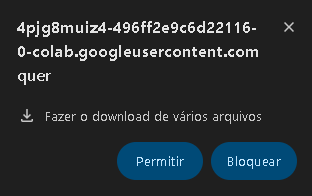
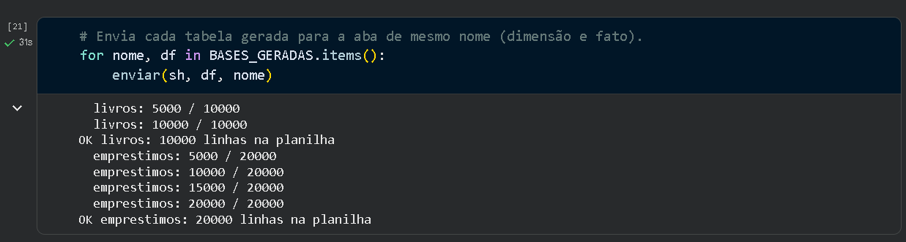
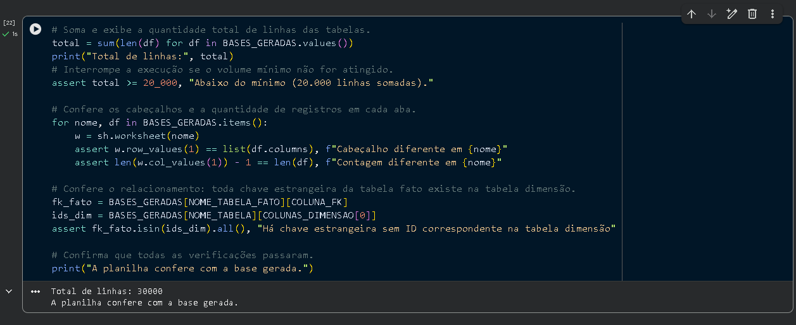
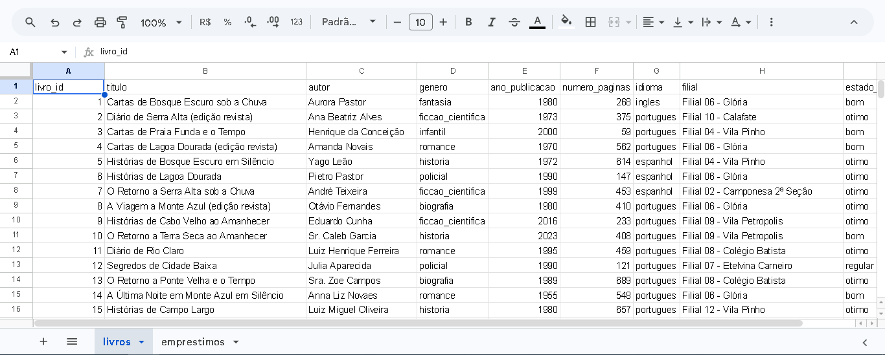

# Guia do Desafio 01 · Analista de Dados

<div align="center"></div>

**Parte 3 de 3 — Depois da sessão e referências**

<table width="100%">
  <tr>
    <td align="left" width="33%"><a href="02.md">← Parte 2</a></td>
    <td align="center" width="34%"><a href="../README.md">README</a></td>
    <td align="right" width="33%"><strong>Fim do guia</strong></td>
  </tr>
</table>


---

# Sessão Assíncrona — Prática

**Objetivo:** concluir a entrega no mesmo notebook da sessão síncrona. Você vai definir o esquema e a estrutura da tabela **fato**, gerar a sua própria base grande, exportá-la em arquivos CSV e carregá-la na planilha.

| **Etapa** | **O que você faz**                                                         | **Passos** |
| --------- | -------------------------------------------------------------------------- | ---------- |
| 1         | Definir o esquema e a estrutura da tabela fato                             | 10         |
| 2         | Gerar a base grande com Python e exportá-la em CSV                         | 11         |
| 3         | Enviar a base gerada para a planilha e validar                             | 12 e 13    |
| 4         | Registrar o uso de IA e entregar no Canvas                                 | 14 e 15    |

<br />

---

## 👣Passo 10 — Definir o esquema e a estrutura da tabela fato

A tabela **fato** guarda os eventos do seu tema (movimentações, atendimentos, visualizações etc.) e **referencia a tabela dimensão por uma chave estrangeira**. Na Parte 2 você já definiu o esquema e a função de geração da dimensão (Células 04 e 05). Para a fato, é necessário **criar a estrutura**, em duas células que repetem a lógica das anteriores:

| **Célula**                   | **Repete a lógica da** | **O que faz**                                                |
| ---------------------------- | ---------------------- | ------------------------------------------------------------ |
| 07 · Esquema – Tabela Fato   | Célula 04              | Define o nome, as colunas e a chave estrangeira da tabela fato |
| 08 · Estrutura – Tabela Fato | Célula 05              | Cria a função que gera um registro da tabela fato            |

Use o mesmo notebook, continuando depois da Célula 06. O nome da tabela fato do seu tema está na tabela abaixo.

|                                                              | \#   | Tema                   | Pasta                     | Dimensão  | Fato               |
| ------------------------------------------------------------ | ---- | ---------------------- | ------------------------- | --------- | ------------------ |
|  | 1    | Estacionamento         | 01-estacionamento         | vagas     | movimentacoes      |
|  | 2    | Posto de Saúde         | 02-posto-de-saude         | pacientes | atendimentos       |
|  | 3    | Streaming de filmes    | 03-streaming-de-filmes    | filmes    | visualizacoes      |
|  | 4    | Atendimento ao cliente | 04-atendimento-ao-cliente | clientes  | chamados           |
|  | 5    | Passagens aéreas       | 05-passagens-aereas       | voos      | reservas           |
|  | 6    | Serviço meteorológico  | 06-servico-meteorologico  | estacoes  | leituras           |
|  | 7    | Telemetria esportiva   | 07-telemetria-esportiva   | pilotos   | voltas             |
|  | 8    | Festival de música     | 08-festival-de-musica     | atracoes  | ingressos_vendidos |

<br />

### Célula 07 · Esquema – Tabela Fato

**O que esta célula faz:** define o nome da tabela fato, a lista de colunas (`COLUNAS_FATO`) e qual delas é a chave estrangeira (`COLUNA_FK`). Como a `COLUNAS_DIMENSAO` da Célula 04, essas variáveis são declaradas uma única vez e reutilizadas nas células seguintes. A guia da tabela fato na planilha será criada no Passo 12, quando a base gerada for enviada.

``` python
# Nome da tabela fato do seu tema (veja a tabela acima). Ele será o nome da segunda guia da planilha.
NOME_TABELA_FATO = "nome_da_tabela_fato"

# Substitua pelos nomes EXATOS de coluna da tabela fato, na mesma ordem do plano.
COLUNAS_FATO = ["coluna_1", "coluna_2", "coluna_3"]

# Nome da coluna da tabela fato que é a chave estrangeira (a que guarda o ID da tabela dimensão).
COLUNA_FK = "coluna_2"

# Confere se a chave estrangeira é mesmo uma das colunas da tabela fato.
assert COLUNA_FK in COLUNAS_FATO, "COLUNA_FK precisa ser um dos nomes de COLUNAS_FATO"
print(NOME_TABELA_FATO, "|", COLUNAS_FATO)
```

<br />

---

### Célula 08 · Estrutura – Tabela Fato

**O que esta célula faz:** cria a função `gerar_linha_fato(i, ids_dim)`, que devolve **um registro** da tabela fato, com uma chave para cada nome de `COLUNAS_FATO`. Funciona como a `gerar_linha` da Célula 05, e a Célula 09 vai chamá-la uma vez para cada linha da base.

A novidade em relação à tabela dimensão é o **relacionamento**: a chave estrangeira precisa apontar para um ID que **existe** na tabela dimensão. Por isso a função recebe o parâmetro `ids_dim`, a lista de IDs da dimensão gerada (criada na Célula 09), e sorteia a chave estrangeira nela.

> [!TIP]
>
> ### Como montar a função `gerar_linha_fato`
>
> 1. **Leia a documentação do seu tema** e anote, para cada coluna da tabela **fato**, o tipo, o formato e as regras ou valores permitidos.
> 2. **Crie uma chave para cada coluna** de `COLUNAS_FATO`, com o mesmo nome.
> 3. **Reaproveite os exemplos da Célula 05** (categorias, números, datas, textos) e copie a linha parecida com o tipo de cada coluna. O código abaixo traz apenas os exemplos que são **novos** na tabela fato.
> 4. **Chave estrangeira:** use sempre `random.choice(ids_dim)`. Nunca invente um ID.
> 5. **Valores que dependem de outros:** sorteie os valores de origem primeiro, guarde em variáveis e calcule a coluna a partir delas.
> 6. **Apague os exemplos que não serão utilizados** e teste com a linha `print(gerar_linha_fato(1, [1, 2, 3]))` do código.
> 7. **Lembre-se das regras do Passo 4:** dados fictícios, nada que lembre uma pessoa real e registro de qualquer trecho gerado com IA.

<br />

``` python

def gerar_linha_fato(i, ids_dim):
    # Devolve UM registro fictício, no formato {nome_da_coluna: valor}.
    # "i" é o número da linha; "ids_dim" é a lista de IDs que existem na tabela dimensão.
    # ATENÇÃO: as chaves precisam ser exatamente os nomes de COLUNAS_FATO (Célula 07).
    # Os exemplos abaixo são apenas ESTRUTURA: substitua pelas colunas do seu tema
    # e use também os exemplos da Célula 05 para os demais tipos de coluna.

    # --- Valores de origem, reaproveitados em colunas calculadas ---
    base = random.randint(1, 5)
    fator = round(random.uniform(10, 100), 2)

    return {
        "coluna_1": i,                                                         # ex.: identificador sequencial
        "coluna_2": random.choice(ids_dim),                                   # ex.: CHAVE ESTRANGEIRA: um ID que existe na tabela dimensão
        "coluna_3": fake.date_time_between(start_date=date(2025, 1, 1), end_date=date(2025, 12, 31)).strftime("%Y-%m-%d %H:%M:%S"),   # ex.: data e hora em um intervalo
        "coluna_4": base,                                                      # ex.: valor de origem sorteado
        "coluna_5": round(base * fator, 2),                                    # ex.: valor calculado a partir de outros (base × fator)
        "coluna_6": random.random() < 0.8,                                     # ex.: verdadeiro ou falso (80% de chance de True)
    }

# Teste opcional: descomente a linha abaixo para ver um registro e comparar com o plano.
# Os IDs [1, 2, 3] são de mentira, só para este teste (a Célula 09 usa os IDs da dimensão gerada).
# print(gerar_linha_fato(1, [1, 2, 3]))
```

<br />

---

## 👣Passo 11 — Gerar a base completa e exportar em CSV

Neste passo você gera uma base grande para o seu tema, seguindo o plano de esquema, e a **grava em arquivos CSV**. A tabela **dimensão** reaproveita a estrutura que você usou na Parte 2 (Célula 05) e a tabela **fato** usa a estrutura criada no Passo 10 (Célula 08).

## O que a geração exige

- **Duas tabelas** (dimensão e fato), com os **nomes de coluna da ficha**, na mesma ordem, sem alteração.
- **Volumetria mínima de 20.000 linhas somadas.**
- Gere primeiro a tabela de referência (dimensão) e depois a fato, **reaproveitando os IDs** da dimensão. Toda chave estrangeira deve apontar para um ID que existe.
- **Regras do plano** do seu tema: valores permitidos, distribuições, formatos e coerência entre colunas e entre datas.
- Dado 100% fictício, nada que pareça dado pessoal real.
- Arquivos CSV com o **nome da tabela**, gravados no final.
- **Registre o uso de IA** nos trechos em que você a utilizar (Passo 14).

## Dicas

- **Tabela dimensão:** utilize a estrutura usada no teste. A função `gerar_linha(i)` da Célula 05 já traz a regra de cada coluna; basta chamá-la uma vez para cada linha, sem reescrever nada.
- **Tabela fato:** a estrutura é a função `gerar_linha_fato(i, ids_dim)` criada na Célula 08. Ela recebe a lista de IDs da dimensão **gerada neste passo**, que a Célula 09 cria (`ids_dim`) e passa a cada chamada. Sem essa lista, a função não tem de onde sortear a chave estrangeira.
- As Células 04, 05, 07 e 08 precisam estar executadas: a Célula 09 usa `gerar_linha`, `gerar_linha_fato`, `fake`, `COLUNAS_DIMENSAO` e `COLUNAS_FATO`.
- Para mudar uma regra (valores permitidos, pesos, datas), altere `gerar_linha` ou `gerar_linha_fato`; a base grande segue a mesma regra.
- Confira se algum nome gerado coincide com alguém que você conhece.
- Gere em etapas e valide cada tabela antes de seguir.

### Célula 09 · Gerar as tabelas

**O que esta célula faz:** define a quantidade de linhas e cria as duas tabelas. A **tabela dimensão** chama a função `gerar_linha` (Célula 05) uma vez por linha. Na **tabela fato**, `ids_dim` é a lista de IDs da dimensão gerada e é passada como argumento para a função `gerar_linha_fato` (Célula 08), chamada uma vez por linha. As duas tabelas ficam guardadas em `BASES_GERADAS`. A geração leva alguns segundos.

``` python
# Quantidade de linhas de cada tabela. O total precisa ser de pelo menos 20.000.
N_DIM = 10_000
N_FATO = 20_000

# Reinicia as sementes (como na Célula 05): o resultado fica reproduzível.
Faker.seed(42)
random.seed(42)

# ---- Tabela dimensão: usa a função gerar_linha (Célula 05) ----
# gerar_linha devolve um dicionário por linha; o DataFrame organiza as colunas na ordem de COLUNAS_DIMENSAO.
tabela_dim = pd.DataFrame([gerar_linha(i) for i in range(1, N_DIM + 1)], columns=COLUNAS_DIMENSAO)

# ---- Tabela fato: usa a função gerar_linha_fato (Célula 08) ----
# ids_dim é a lista de IDs da dimensão GERADA acima: é nela que a fato sorteia a chave estrangeira.
ids_dim = list(tabela_dim[COLUNAS_DIMENSAO[0]])
tabela_fato = pd.DataFrame([gerar_linha_fato(i, ids_dim) for i in range(1, N_FATO + 1)], columns=COLUNAS_FATO)

# Guarda as tabelas usando o nome de cada uma (NOME_TABELA e NOME_TABELA_FATO).
BASES_GERADAS = {NOME_TABELA: tabela_dim, NOME_TABELA_FATO: tabela_fato}

# Exibe a quantidade de linhas geradas e o total.
print({nome: len(df) for nome, df in BASES_GERADAS.items()}, "| total:", len(tabela_dim) + len(tabela_fato))
```

<br />

### Célula 10 · Validar e gerar os arquivos CSV

**O que esta célula faz:** confere se as colunas seguem a ficha, se os IDs da dimensão são únicos, se toda chave estrangeira existe e se o volume mínimo foi atingido. Só depois grava um CSV por tabela na pasta `bases_geradas`, lê cada arquivo de volta para conferir e o baixa para o seu computador. O navegador pode pedir permissão para baixar mais de um arquivo.

``` python
# Confere se as colunas de cada tabela seguem o esquema da ficha (Células 04 e 07).
assert list(tabela_dim.columns) == COLUNAS_DIMENSAO, "Colunas diferentes do esquema na tabela dimensão"
assert list(tabela_fato.columns) == COLUNAS_FATO, "Colunas diferentes do esquema na tabela fato"

# Confere o ID único na dimensão, a chave estrangeira na fato e o volume mínimo.
assert tabela_dim[COLUNAS_DIMENSAO[0]].is_unique, "ID repetido na tabela dimensão"
assert tabela_fato[COLUNA_FK].isin(tabela_dim[COLUNAS_DIMENSAO[0]]).all(), "Chave estrangeira sem ID na dimensão"
assert len(tabela_dim) + len(tabela_fato) >= 20_000, "Abaixo do mínimo (20.000 linhas somadas)."

# Para cada tabela: grava o CSV, lê de volta para conferir e baixa o arquivo.
os.makedirs("bases_geradas", exist_ok=True)
for nome, df in BASES_GERADAS.items():
    caminho = f"bases_geradas/{nome}.csv"
    df.to_csv(caminho, index=False, encoding="utf-8")
    lido = pd.read_csv(caminho)
    assert len(lido) == len(df) and list(lido.columns) == list(df.columns), f"CSV diferente em {nome}"
    print(nome + ".csv ->", len(lido), "linhas")
    files.download(caminho)
```

1. Ao executar esta célula, será exibida uma mensagem perguntando se você deseja baixar os 2 arquivos:

<div align="center"></div>

2. Clique no botão **Permitir** e aguarde a conclusão do download.

<br />

---

## 👣Passo 12 — Enviar a base gerada para a planilha

A API limita o número de escritas por minuto. Por isso o envio é feito em **lotes de 5.000 linhas** com uma pausa de 2 segundos entre eles. Os números são gravados como números e as datas como texto no formato AAAA-MM-DD.

### Célula 11 · Função para o envio de dados - Planilha

**O que esta célula faz:** define a função `enviar`, que grava uma tabela do `pandas` em uma aba da planilha, em lotes, e confere ao final a contagem de linhas. Se a aba já existe (como a da dimensão, criada na Célula 03), ela é limpa e reaproveitada; se não existe (como a da fato), é criada. As bibliotecas `time` e `gspread` já foram importadas na Célula 02.

``` python
def enviar(sh, df, nome_aba, lote=5000, pausa=2):
    # Reaproveita a aba se ela já existir (limpando o conteúdo) ou cria uma nova.
    try:
        aba = sh.worksheet(nome_aba)
        aba.clear()
    except gspread.WorksheetNotFound:
        aba = sh.add_worksheet(title=nome_aba, rows=len(df) + 1, cols=len(df.columns))

    # Ajusta o tamanho da aba e grava o cabeçalho na linha 1.
    aba.resize(rows=len(df) + 1, cols=len(df.columns))
    aba.update(range_name="A1", values=[list(df.columns)])

    # Converte a tabela em lista de linhas (valor ausente vira texto vazio).
    valores = df.astype(object).where(df.notna(), "").values.tolist()

    # Envia em lotes, com pausa para respeitar o limite de escritas por minuto.
    for i in range(0, len(valores), lote):
        aba.append_rows(valores[i:i + lote], value_input_option="RAW")
        print(f"  {nome_aba}: {min(i + lote, len(valores))} / {len(valores)}")
        time.sleep(pausa)

    # Lê de volta e confere a quantidade de linhas (sem contar o cabeçalho).
    lidas = len(aba.col_values(1)) - 1
    if lidas != len(df):
        raise RuntimeError(f"Aba {nome_aba}: enviei {len(df)}, li {lidas}.")
    print(f"OK {nome_aba}: {len(df)} linhas na planilha")
```

<br />

### Célula 12 · Enviar as tabelas geradas

**O que esta célula faz:** envia cada tabela de `BASES_GERADAS` para a aba de mesmo nome: a dimensão e a fato.

``` python
# Envia cada tabela gerada para a aba de mesmo nome (dimensão e fato).
for nome, df in BASES_GERADAS.items():
    enviar(sh, df, nome)
```

As 10 linhas de teste da dimensão (Parte 2) são substituídas: a função limpa a aba e reescreve cabeçalho e dados. A aba da tabela fato é criada nesse momento. Pode executar de novo sem duplicar linhas.

1.  Observe que os dados são enviados em lotes de 5000 linhas



> [!NOTE]
>
> Se o Colab for reiniciado antes do envio, execute de novo as Células 01 a 05, 07 a 09 e 11. As sementes fixas fazem a base sair igual, e o envio limpa a aba da dimensão, então as linhas de teste repetidas da Célula 05 não ficam na planilha.

<br />

---

## 👣Passo 13 — Validar a base na planilha

### Célula 13 · Validar

**O que esta célula faz:** lê de volta a planilha e compara com as tabelas geradas: total de linhas, cabeçalho e contagem de cada aba e o relacionamento entre fato e dimensão.

``` python
# Soma e exibe a quantidade total de linhas das tabelas.
total = sum(len(df) for df in BASES_GERADAS.values())
print("Total de linhas:", total)
# Interrompe a execução se o volume mínimo não for atingido.
assert total >= 20_000, "Abaixo do mínimo (20.000 linhas somadas)."

# Confere os cabeçalhos e a quantidade de registros em cada aba.
for nome, df in BASES_GERADAS.items():
    w = sh.worksheet(nome)
    assert w.row_values(1) == list(df.columns), f"Cabeçalho diferente em {nome}"
    assert len(w.col_values(1)) - 1 == len(df), f"Contagem diferente em {nome}"

# Confere o relacionamento: toda chave estrangeira da tabela fato existe na tabela dimensão.
fk_fato = BASES_GERADAS[NOME_TABELA_FATO][COLUNA_FK]
ids_dim = BASES_GERADAS[NOME_TABELA][COLUNAS_DIMENSAO[0]]
assert fk_fato.isin(ids_dim).all(), "Há chave estrangeira sem ID correspondente na tabela dimensão"

# Confirma que todas as verificações passaram.
print("A planilha confere com a base gerada.")
```

1.  Observe que os dados foram validados.



Depois da conferência no código, **abra a planilha** e verifique à mão:

- Uma aba por tabela, com o nome da tabela.

- Cabeçalho na linha 1 igual ao da ficha, sem nome de coluna alterado.

- A última linha de cada aba tem o número esperado de registros.

- Nenhum dado é nem parece dado pessoal real de alguém.



> [!NOTE]
>
> No tema **Posto de Saúde**, que trata de dado de saúde (sensível mesmo quando fictício), confira com atenção redobrada que nenhum nome da coluna `nome` coincide com alguém que você conhece.

<br />

---

## 👣Passo 14 — Registrar o uso de IA no código

Revise o notebook inteiro. **Acima de cada trecho que foi gerado ou ajustado com apoio de IA**, inclua o registro do Passo 4, informando a ferramenta e a data:

``` python
# Generated-by: AI (Gemini / GPT-4 / Claude)
# AI-Generated-Date: AAAA-MM-DD
# SPDX-SnippetCopyrightText: AI-Assisted Code
# SPDX-License-Identifier: MIT
```

- Verifique as células em que você escreveu código próprio: **05** e **08** (`gerar_linha` e `gerar_linha_fato`). A Célula 09 apenas reaproveita essas duas funções.
- Se um nome, categoria ou texto de exemplo veio de uma IA, registre. Se nenhum trecho usou IA, não há o que registrar.
- Lembre: números e estatísticas sugeridos por IA devem ser **verificados**, nunca apresentados como fato real.

<br />

---

## 👣Passo 15 — Entregar no Canvas

A entrega é o **link do repositório no GitHub** com o notebook e o acesso à planilha com os dados.

1.  No Colab, salve o notebook no repositório criado no Passo 1B (**projeto_desafios_tecnicos_ad**): **Arquivo → Salvar uma cópia no GitHub**.
2.  Confirme que o notebook **não contém a credencial**: ela fica nas Secrets do Colab, nunca no código nem no repositório.
3.  **Envie para o GitHub** os arquivos de apoio: 
    1.  No repositório criado, clique em **Add file → Upload files** 
    2.  Arraste uma cópia da planilha no formato `.xlsx` 
    3.  Arraste também os 2 arquivos CSV gerados no Passo 11.
    4.  Depois clique em **Commit changes**. 

4.  Confira a lista final: duas abas com os nomes das tabelas, cabeçalhos iguais aos da documentação da base e nenhum dado pessoal real.
5.  Entregue no **Canvas** o link do repositório do GitHub.

<br />

> [!WARNING]
>
> ### Confira o que o notebook salvou
>
> O notebook guarda junto o resultado de cada célula, e ele vai para um repositório **público**. As Células 02 e 03 exibem o `client_email` da credencial e o link da planilha: compartilhe a planilha somente com quem precisa. Nunca exiba o conteúdo da secret `GCP_SA_JSON` (a variável `info`) em nenhuma célula, nem para testar, porque a chave ficaria gravada no histórico do repositório. Antes de salvar no GitHub, role o notebook e confira todas as saídas.

<br />

---

# Quando algo não funciona

Um script correto pode rodar sem erro e a planilha continuar vazia. A ausência de erro mostra apenas que o código executou, não que a operação funcionou. O passo que evita a dúvida é sempre o mesmo: **ler de volta da planilha** e comparar com o que você enviou.

### Planilha não atualiza, e não há mensagem de erro

| **Causa provável**                                        | **Como verificar**                                                              |
| --------------------------------------------------------- | ------------------------------------------------------------------------------- |
| Planilha não compartilhada com o client_email             | Compartilhar → conferir a lista de pessoas; o papel deve ser Editor             |
| Script escreve em outra planilha ou outra aba             | print(sh.title, ws.title, sh.url) e abrir o link impresso                       |
| Célula de escrita não foi executada, ou foi fora de ordem | Executar o notebook de cima para baixo e conferir a contagem de linhas enviadas |
| try/except que esconde o erro                             | Remover o except genérico ou imprimir a exceção                                 |
| Olhando a planilha ou a conta Google errada               | Abrir sh.url na mesma conta usada no passo 5                                    |

### Mensagens de erro mais comuns

| **Mensagem**                                   | **Causa**                                          | **Correção**                                                                       |
| ---------------------------------------------- | -------------------------------------------------- | ---------------------------------------------------------------------------------- |
| APIError ... 403 ... PERMISSION_DENIED         | Planilha não compartilhada com a credencial        | Compartilhar com o client_email como Editor                                        |
| Google Sheets API has not been used in project | API não ativada                                    | Ativar a Sheets API no projeto (passo 1)                                           |
| SpreadsheetNotFound                            | ID errado ou sem acesso                            | Recopiar o ID da URL e rever o compartilhamento                                    |
| KeyError: 'nome_da_coluna'                     | Nome diferente do esquema                          | Corrigir gerar_linha ou gerar_linha_fato para usar os nomes de COLUNAS_DIMENSAO e COLUNAS_FATO |
| AssertionError: Chave estrangeira sem ID na dimensão | A tabela fato usa um ID que não existe na dimensão | Sortear a chave estrangeira apenas entre ids_dim e executar as Células 09 e 10 de novo |
| NameError: name '...' is not defined           | Uma célula anterior não foi executada, ou o Colab foi reiniciado | Executar o notebook de cima para baixo, na ordem das células |
| AssertionError: Colunas diferentes do esquema ... | As chaves de gerar_linha ou gerar_linha_fato diferem de COLUNAS_DIMENSAO ou COLUNAS_FATO | Corrigir os nomes e a ordem nas Células 04, 05, 07 e 08 e executá-las de novo |
| APIError ... 429 ... Quota exceeded            | Muitas escritas por minuto                         | Esperar um minuto, reduzir o tamanho do lote ou aumentar a pausa                   |
| Código Python colado no Apps Script não roda   | Python não executa no Apps Script                  | Rodar o código no Colab                                                            |

# Termos principais

| **Termo**         | **Significado**                                                                            |
| ----------------- | ------------------------------------------------------------------------------------------ |
| API               | Interface de Programação de Aplicações: a forma como um programa pede algo a outro sistema |
| Autenticação      | A chave de acesso (credencial) que prova quem está pedindo acesso a um serviço             |
| Google Sheets API | A porta de entrada que o Python usa para ler e escrever numa planilha do Google            |
| Apps Script       | Código do Google em JavaScript que roda dentro do Google (não é Python)                    |
| Dado mockado      | Dado fictício, gerado para treino                                                          |
| Esquema de dados  | Os nomes e tipos das colunas de uma tabela                                                 |
| Tabela dimensão   | Tabela de cadastro: a entidade central do tema, com identificador único                    |
| Tabela fato       | Tabela de eventos ao longo do tempo, que referencia a dimensão                             |
| Chave estrangeira | Coluna da tabela fato que guarda o ID de um registro existente na tabela dimensão          |
| CSV               | Arquivo de texto com uma tabela, em que as colunas são separadas por vírgula               |
| IA responsável    | Usar IA sem apresentar o resultado como fato verificado                                    |

# ANEXO I – Principais HTTP Status Code

**Sucesso**

| Código | Nome       | Descrição / Uso                                                                                    |
| ------ | ---------- | -------------------------------------------------------------------------------------------------- |
| 200    | OK         | Requisição bem-sucedida. Padrão para respostas GET, PUT ou PATCH que retornam dados.               |
| 201    | Created    | Recurso criado com sucesso. Muito comum após uma requisição POST.                                  |
| 204    | No Content | Requisição processada com sucesso, mas sem conteúdo no corpo da resposta (ex: remoção via DELETE). |

**Erro do Cliente**

| Código | Nome         | Descrição / Uso                                                                        |
| ------ | ------------ | -------------------------------------------------------------------------------------- |
| 400    | Bad Request  | A requisição está malformada ou contém dados inválidos de validação.                   |
| 401    | Unauthorized | O cliente precisa se autenticar para obter a resposta (ausência de token/credenciais). |
| 403    | Forbidden    | O cliente está autenticado, mas não possui permissão para acessar o recurso.           |
| 404    | Not Found    | O recurso solicitado não foi encontrado no servidor.                                   |

**Erro do Servidor**

| Código | Nome                  | Descrição / Uso                                                     |
| ------ | --------------------- | ------------------------------------------------------------------- |
| 500    | Internal Server Error | Erro genérico no servidor (falha não tratada no código).            |
| 502    | Bad Gateway           | O servidor recebeu uma resposta inválida.                           |
| 503    | Service Unavailable   | O servidor está indisponível no momento (manutenção ou sobrecarga). |
| 504    | Gateway Timeout       | O servidor não recebeu resposta a tempo do servidor backend.        |

---

<table width="100%">
  <tr>
    <td align="left" width="33%"><a href="02.md">← Parte 2</a></td>
    <td align="center" width="34%"><a href="../README.md">README</a></td>
    <td align="right" width="33%"><strong>Fim do guia</strong></td>
  </tr>
</table>