# Guia do Desafio 01 · Analista de Dados

<div align="center"></div>

**Parte 1 de 3 — Preparação e conteúdo da sessão**

<table width="100%">
  <tr>
    <td align="left" width="33%"><strong>Início</strong></td>
    <td align="center" width="34%"><a href="../README.md">README</a></td>
    <td align="right" width="33%"><a href="Guia_Desafio1_Google_Colab_Parte2.md">Avançar → Parte 2</a></td>
  </tr>
</table>

---

## 1. Como usar este guia

Este guia conduz você da primeira ideia até a base de dados completa na planilha do Google Sheets, usando Python no Google Colab.

| **Período**    | **Quando**                                                   | **O que é**                                                  |
| -------------- | ------------------------------------------------------------ | ------------------------------------------------------------ |
| **SÍNCRONO**   | Durante a sessão com o Instrutor                             | - Criar a conexão com a planilha<br />- Adicionar 10 linhas de teste da tabela dimensão, na primeira guia da planilha, via código<br />- Validar os dados adicionados |
| **ASSÍNCRONO** | Dentro dos grupos organizados nas Salas do Teams (separadas por tema), depois da sessão síncrona. | - Adicionar 10 linhas de teste da tabela fato, na segunda guia da planilha, via código<br />- Validar os dados adicionados<br />- Carregar a base completa (disponível no repositório) na planilha<br />-  Validar o conteúdo carregado e entregar no Canvas. |

<br />

---

## 2. O que você será capaz de fazer

- Explicar o que é uma API e para que ela serve no trabalho de um analista de dados.

- Escolher um tema de dados entre as oito opções e justificar a escolha.

- Conectar o Python à Google Sheets API (autenticar e escrever dados numa planilha).

- Aplicar o esquema de colunas do tema escolhido ao gerar dados _mockados_.

- Usar IA como apoio na geração de dados, deixando claro quando forem dados simulados e evitando apresentar estatísticas inventadas como resultados reais.

- Reconhecer os limites éticos do uso de IA na geração e no tratamento de dados.


---

## 3. Mapa dos passos

| **Passo** | **O que você faz**                                           | **Quando**        |
| --------- | ------------------------------------------------------------ | ----------------- |
| 1         | Criar a credencial de acesso (service account)               | Sessão Síncrona   |
| 1B        | Criar o repositório no GitHub                                | Sessão Síncrona   |
| 2         | Entender o que é uma API                                     | Sessão Síncrona   |
| 3         | Escolher o tema e ler o esquema de dados                     | Sessão Síncrona   |
| 4         | IA responsável na geração de dados                           | Sessão Síncrona   |
| 5         | Criar a planilha e compartilhar com a credencial             | Sessão Síncrona   |
| 6         | Abrir o Colab e autenticar                                   | Sessão Síncrona   |
| 7         | Escrever o cabeçalho do esquema                              | Sessão Síncrona   |
| 8         | Gerar e escrever 10 linhas de teste na tabela dimensão       | Sessão Síncrona   |
| 9         | Conferir o resultado na planilha                             | Sessão Síncrona   |
| 10        | Gerar e escrever 10 linhas de teste na tabela fato           | Sessão Assíncrona |
| 11        | Carregar as bases completas na planilha do Google Sheets     | Sessão Assíncrona |
| 12        | Enviar para a planilha em lotes de 5000 linhas               | Sessão Assíncrona |
| 13        | Validar a base completa na planilha                          | Sessão Assíncrona |
| 14        | Registrar o uso de IA no código                              | Sessão Assíncrona |
| 15        | Entregar no Canvas o link do Github (Notebook + Planilha com os dados) | Sessão Assíncrona |

---

## 4. Google Colab

O código Python será construído no Google Colab, utilizando **um único notebook**, dividido em duas partes.

A autenticação e as variáveis (planilha, nomes das colunas, função de geração) ficam em um só lugar, e a credencial é configurada uma única vez.

| **Parte**                     | **Células**                                                  | **Quando**                        |
| ----------------------------- | ------------------------------------------------------------ | --------------------------------- |
| **Parte 1 — Conexão e teste** | Células 1 a 6: instalar, autenticar, abrir a planilha, criar cabeçalho, gerar as 10 linhas na tabela dimensão e validar a planilha. | Na sessão (passos 6 a 9)          |
| **Parte 2 — Base completa**   | Células 7 a 10: funções de envio, gerar as 10 linhas da tabela fato com relacionamento, carregar as tabelas, enviar em lotes e validar a planilha | Depois da sessão (passos 11 a 13) |

Se preferir separar, o mesmo código funciona em dois notebooks, mas lembre-se de que as credenciais precisam ser autorizadas em cada um deles individualmente.

---

## 5. O que você precisa ter em mãos

- Uma conta Google (para criar a planilha e usar o Colab).

- Acesso à **documentação das bases de dados dos 8 temas**, para você escolher o seu, contendo o plano de esquema de cada um (nomes de coluna, tipos de tabela e volumetria mínima).

- A credencial de acesso à Google Sheets API.

- O tema já decidido antes de a prática começar.

> [!IMPORTANT]
>
> O **Google Colab** já traz o Python e as principais bibliotecas utilizadas no mercado instaladas e configuradas no ambiente de desenvolvimento, portanto não há necessidade de instalar qualquer software no seu computador.

---

# Preparação

## Google Cloud Console

O **Google Cloud Console** é a interface web utilizada para acessar e gerenciar os serviços do **Google Cloud**. Por meio dele, é possível criar projetos, configurar recursos, acompanhar o uso e administrar serviços de computação, armazenamento, bancos de dados e outros recursos de nuvem.

Na **versão gratuita (Free Tier)**, o Google Cloud oferece acesso a determinados recursos sem custo, dentro dos limites estabelecidos pela plataforma. Isso permite que estudantes e iniciantes pratiquem conceitos de computação em nuvem sem necessariamente gerar cobranças, desde que permaneçam dentro das condições do nível gratuito.

---

## 👣Passo 1 — Criar a credencial de acesso

A credencial é o que prova ao Google **quem** está pedindo acesso à planilha. Este guia usa uma **service account** (uma “conta de robô” com chave em arquivo JSON).

> [!TIP]
>
> ### Nesta atividade recomendamos utilizar o Google Chrome.
>
> Caso você tenha mais de uma conta Google configurada no navegador, recomendamos abrir o Cloud Console em uma guia anônima. Dessa forma, você poderá acessar a conta necessária para a atividade sem interferência de outras contas já conectadas.

<br />

1. Acesse [**console.cloud.google.com**](https://console.cloud.google.com) com sua conta Google e crie um projeto novo (**Projetos → Novo projeto**).

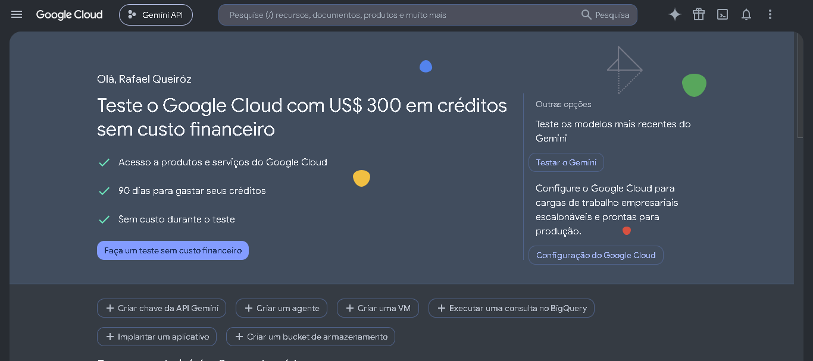

2. Clique no menu do **Google Cloud**, no canto superior direito da tela


3. Clique na opção **APIs e serviços → Biblioteca**,

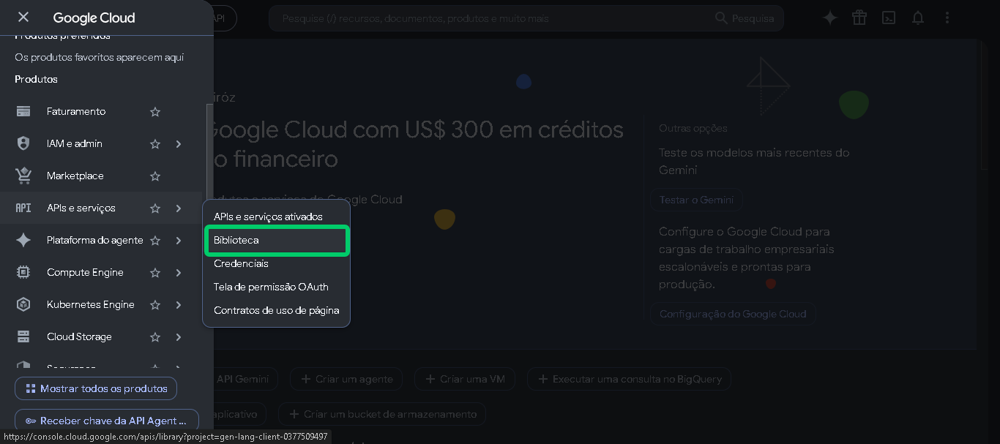

4. Localize o **Google Sheets API** e clique sobre ela para acessar

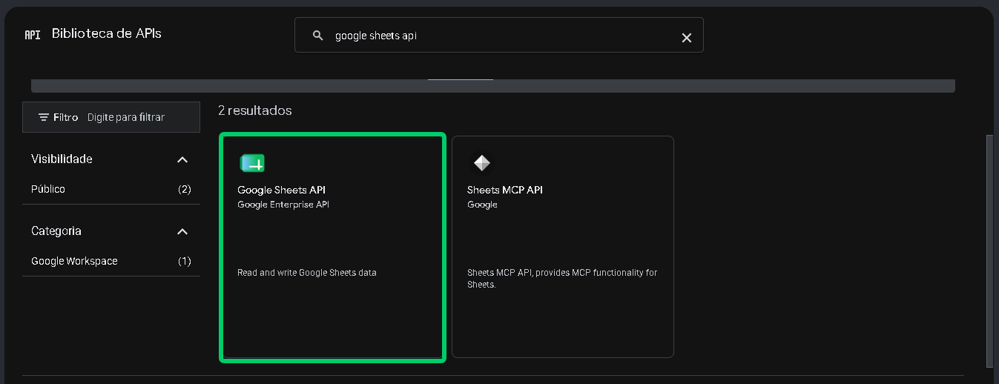

5. Ative o **Google Sheets API** clicando no botão **Ativar**

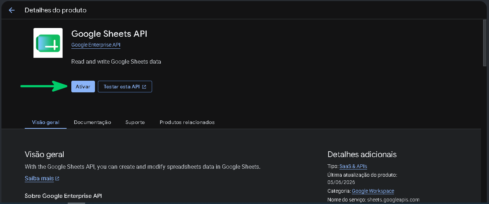

6. **Repita os passos 2 a 5** e ative o **Google Drive API**.

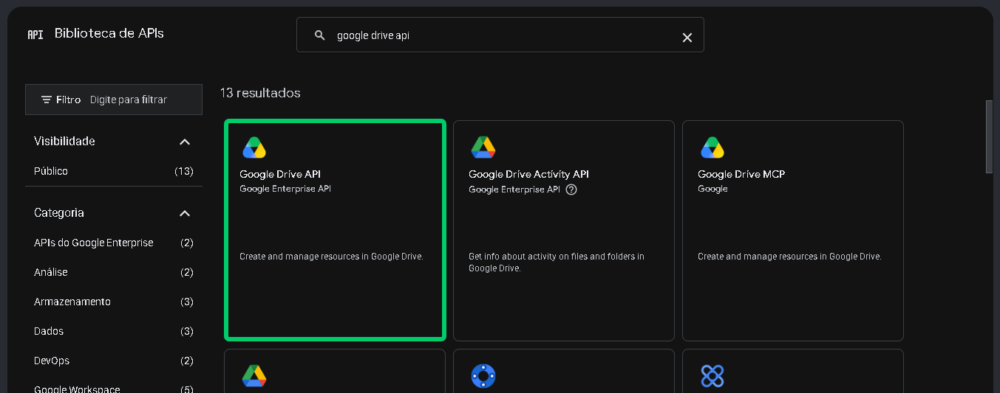

<br />

> [!NOTE]
>
> ### ✅ Google Sheets API
>
> A **Google Sheets API** permite que aplicações **acessem e manipulem planilhas do Google Sheets por meio de código**. É possível ler, inserir, atualizar e excluir dados, além de criar e formatar planilhas.
>
> **Exemplo:** uma aplicação pode registrar automaticamente em uma planilha os dados enviados por um formulário.
>
> ### ✅Google Drive API
>
> A **Google Drive API** permite que aplicações **acessem e gerenciem arquivos armazenados no Google Drive por meio de código**. É possível criar, enviar, baixar, mover, compartilhar e excluir arquivos e pastas, conforme as permissões concedidas.
>
> **Exemplo:** uma aplicação pode criar uma pasta no Drive e enviar automaticamente arquivos gerados pelo sistema.

<br />

7. No menu do **Google Cloud**, clique em **IAM e admin → Contas de serviço**

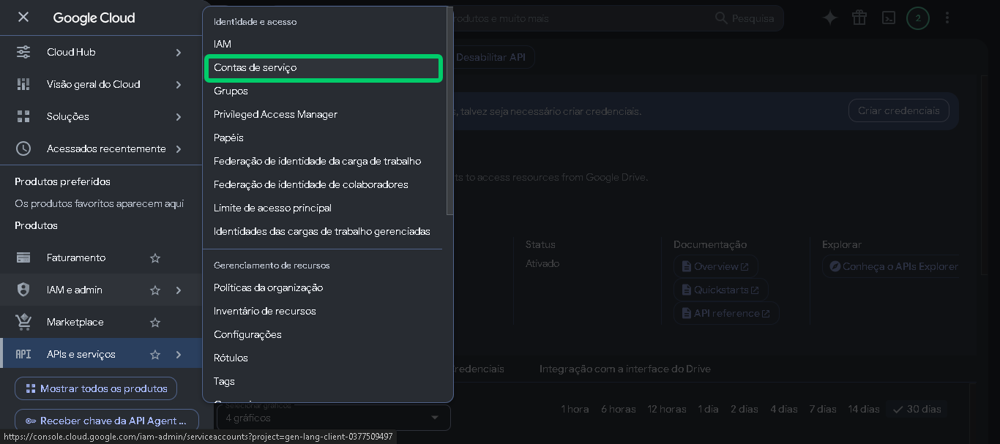

8. Clique em **+ Criar conta de serviço**

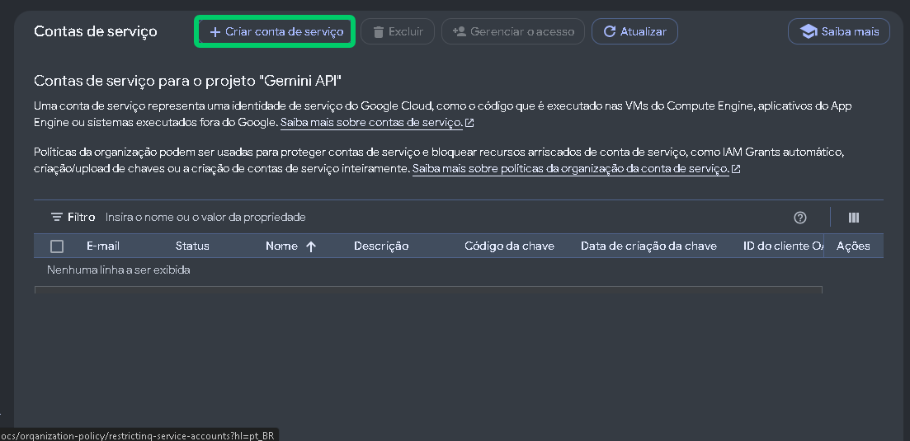

9. Na propriedade **Nome de exibição para esta conta de serviço**, digite **_desafio1-python_** e conclua sem papéis adicionais, clicando no botão **Criar e fechar**

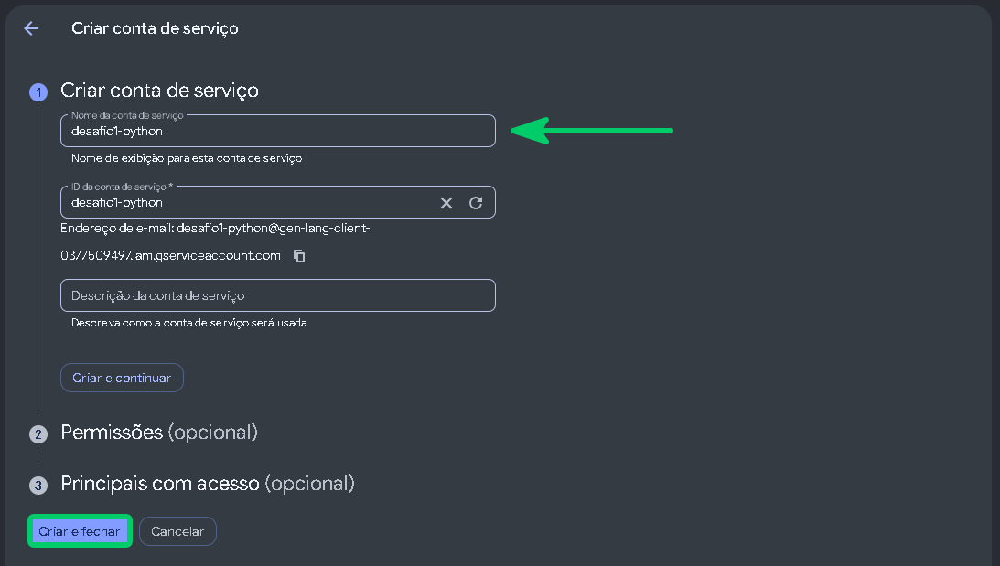

10. Abra a conta criada, clicando sobre ela

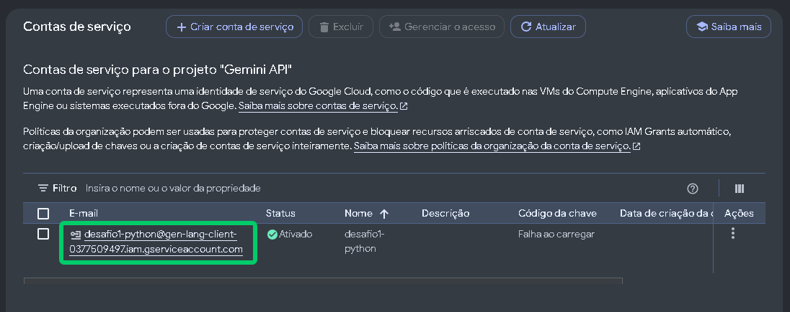

11. Acesse a guia **Chaves**

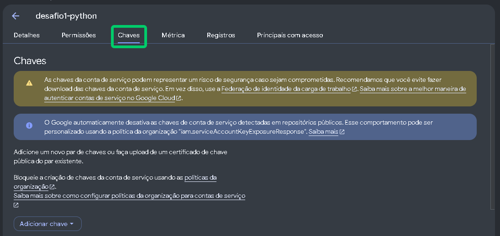

12. Clique no botão **Adicionar chave → Criar nova chave** 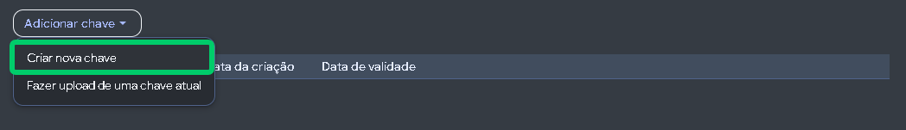

13. Selecione a opção **JSON** e clique no botão **Criar**.

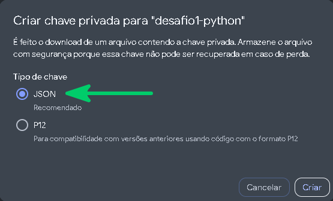

14. O arquivo será baixado no seu computador. Clique no botão **Fechar**


15. Abra o arquivo **JSON** com o Bloco de Notas ou com o Visual Studio Code e copie o valor do atributo **_client_email_** (termina em **iam.gserviceaccount.com**). É para esse e-mail que você vai compartilhar a planilha no passo 5.

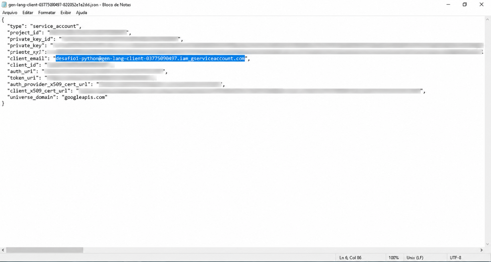

<br />

> [!WARNING]
>
> ### O arquivo JSON funciona como uma senha
>
> **Não publique, não envie por chat e não suba para repositórios no GitHub**. Quem tiver o arquivo acessa tudo o que a credencial acessa. Se a sua conta de organização bloquear a criação de chaves, peça ajuda ao instrutor.

<br />

---

## 👣Passo 1B — Criar o repositório no GitHub

1. Acesse a sua conta pessoal no GitHub
2. Crie um **Repositório Público** chamado: **projeto_desafios_tecnicos_ad**
3. Ao criar o repositório, adicione o **README.md**

<br />

> [!WARNING]
>
> Este repositório será utilizado durante todo o Desafio Técnico. Mais adiante, vamos personalizar o arquivo README.md.

<br />

---

# Sessão Síncrona

Os três passos a seguir correspondem aos conteúdos trabalhados na sessão.

## 👣Passo 2 — Entender o que é uma API

Nesta sessão, estudamos o que é uma API e como o Python conversa com o Google Sheets.

### 🔑Pontos Chave

- **API (Interface de Programação de Aplicações)** é um contrato entre dois sistemas: você pede algo num formato combinado e recebe a resposta no mesmo formato, sem precisar saber o que acontece por dentro. É a porta de entrada, não a casa inteira.

- A **Google Sheets API** é a porta que o Python usa para ler e escrever numa planilha do Google.

- A API exige **autenticação**: uma credencial que prova quem está pedindo o acesso. A planilha precisa ser compartilhada com ela; sem compartilhar, a escrita falha em silêncio.

- **Apps Script** roda dentro do Google, em JavaScript. O seu script **Python** roda fora, no Colab, e conversa com a planilha pela API. São ferramentas diferentes que se falam pela API. Não cole código Python no editor do Apps Script: não funciona.

- Bibliotecas como **gspread** ou **google-api-python-client** encapsulam a comunicação, para você não montar a chamada HTTP à mão.

- Cada linha escrita pela API é uma linha real, visível na hora, como se alguém tivesse digitado.

- Erros de permissão são o problema mais comum. Leia o erro retornado: quase sempre ele indica a causa.

- Toda requisição enviada a uma API recebe um HTTP Status Code, que indica o sucesso ou o insucesso da requisição. Consulte o **Anexo I – Principais HTTP Status Code**.


---

## 👣Passo 3 — Escolher o tema e ler a Documentação da Base de Dados

O tema que você escolher hoje acompanha você até o fim do bootcamp: ele volta nos desafios de **Estatística, Excel, SQL e Big Data**. Escolha pensando em curiosidade real, não só no tema mais fácil.

|                                                                                             | **#** | **Tema**               | **O que representa**                        |
| ------------------------------------------------------------------------------------------- | ----- | ---------------------- | ------------------------------------------- |
|                  | 1     | Estacionamento         | Vagas e movimentação de veículos            |
|                  | 2     | Posto de Saúde         | Triagem de pacientes (dados 100% fictícios) |
|        | 3     | Streaming de filmes    | Catálogo e visualizações                    |
|  | 4     | Atendimento ao cliente | Chamados e satisfação                       |
|              | 5     | Passagens aéreas       | Voos e reservas                             |
|    | 6     | Serviço meteorológico  | Estações e leituras                         |
|      | 7     | Telemetria esportiva   | Pilotos e voltas de corrida                 |
|          | 8     | Festival de música     | Atrações e ingressos vendidos               |

Por que a escolha pesa:

- Trocar de tema no meio do caminho custa retrabalho em tudo que já foi construído.

- Cada tema já tem um **plano de esquema pronto**: nomes de coluna, tipos de tabela e volumetria mínima de **20.000 linhas somadas**. As bases geradas pelo script de cada tema ficam acima desse mínimo, com entre 52 mil e 72 mil linhas.

- Usar o esquema não é limitação, é consistência: os próximos desafios dependem do **nome exato** de cada coluna, e um nome errado gera erro adiante.

<br />

> [!TIP]
>
> ### Repositório base do Desafio
>
> A documentação das 8 Bases de dados está disponível [**aqui**](https://github.com/rafaelq80/desafios_tecnicos_ad/bases_dados).

<br />

## 👣Passo 4 — IA responsável na geração de dados

A IA pode ajudar a gerar nomes fictícios, textos de exemplo e sugestões de distribuição. **A IA acelera, você verifica.**

- Usar IA para sugerir nomes fictícios, categorias e textos de exemplo é uma boa prática.

- **Nunca** aceite de uma IA um número ou estatística apresentado como fato real sem verificar a fonte.

- **Nunca** peça dados pessoais de alguém real, nem como exemplo. Dado mockado não pode ser nem parecer dado pessoal de ninguém: colega, família ou outra pessoa.

- **Registre no seu código** quando um trecho foi gerado com apoio de IA.

**Exemplo**

```python
# Generated-by: AI (Gemini / GPT-4 / Claude)
# AI-Generated-Date: 2026-11-14
# SPDX-SnippetCopyrightText: AI-Assisted Code
# SPDX-License-Identifier: MIT

def sobrenome_inventado():
    # Sobrenome montado de sílabas aleatórias: não corresponde a ninguém real
    return "".join(random.choices(SILABAS, k=3)).capitalize()
```

- Revise sempre se o dado gerado respeita o esquema de colunas do tema.

Para gerar grandes volumes de dados, prefira a biblioteca **Faker** (Python) à IA generativa:

| **Situação**                                                   | **Ferramenta** | **Por quê**                                       |
| -------------------------------------------------------------- | -------------- | ------------------------------------------------- |
| Muitas linhas repetitivas (centenas ou milhares)               | Faker (Python) | Rápido e sem risco de alucinação em grande volume |
| Casos pontuais: nomes fictícios, categorias, textos de exemplo | IA generativa  | Boa para variedade, mas você verifica o resultado |

Combine as duas conforme a necessidade. Exemplo de pedido que deixa claro que o dado é fictício:

> [!TIP]
>
> ### Exemplo de prompt
>
> _“Gere 10 nomes **claramente inventados**, sem usar nomes de pessoas reais ou conhecidas, no formato do meu esquema de colunas. Não invente estatísticas.”_

---

<table width="100%">
  <tr>
    <td align="left" width="33%"><strong>Início</strong></td>
    <td align="center" width="34%"><a href="../README.md">README</a></td>
    <td align="right" width="33%"><a href="Guia_Desafio1_Google_Colab_Parte2.md">Avançar → Parte 2</a></td>
  </tr>
</table>
