# Guia do Desafio 01 · Analista de Dados

<div align="center"></div>

**Parte 2 de 3 — Prática na sessão**

<table width="100%">
  <tr>
    <td align="left" width="33%"><a href="Guia_Desafio1_Google_Colab.md">← Parte 1</a></td>
    <td align="center" width="34%"><a href="../README.md">README</a></td>
    <td align="right" width="33%"><a href="Guia_Desafio1_Google_Colab_Parte3.md">Avançar → Parte 3</a></td>
  </tr>
</table>

---

# Sessão Síncrona — Prática

**Objetivo:** Garantir a **conexão funcional com a planilha** e registrar nela **10 linhas de dados mockados (fictícios)** na primeira tabela, a **dimensão**. O tema da planilha já deve estar definido antes de iniciar a atividade.

---

## 👣Passo 5 — Criar a planilha e compartilhar com a credencial

1.  Acesse [**sheets.new**](https://sheets.new) com sua conta Google
1.  Crie uma nova planilha e defina o nome da planilha conforme a tabela abaixo:

|                                                              | **#** | **Tema**               | **Nome da Planilha**            |
| ------------------------------------------------------------ | ----- | ---------------------- | ------------------------------- |
|  | 1     | Estacionamento         | Desafio_01_Estacionamento       |
|  | 2     | Posto de Saúde         | Desafio_01_Posto_Saude          |
|  | 3     | Streaming de filmes    | Desafio_01_Streaming_Filmes     |
|  | 4     | Atendimento ao cliente | Desafio_01_Atendimento_Cliente  |
|  | 5     | Passagens aéreas       | Desafio_01_Passagens_Aereas     |
|  | 6     | Serviço meteorológico  | Desafio_01_Meteorologia         |
|  | 7     | Telemetria esportiva   | Desafio_01_Telemetria_Esportiva |
|  | 8     | Festival de música     | Desafio_01_Festival_Musica      |

<br />

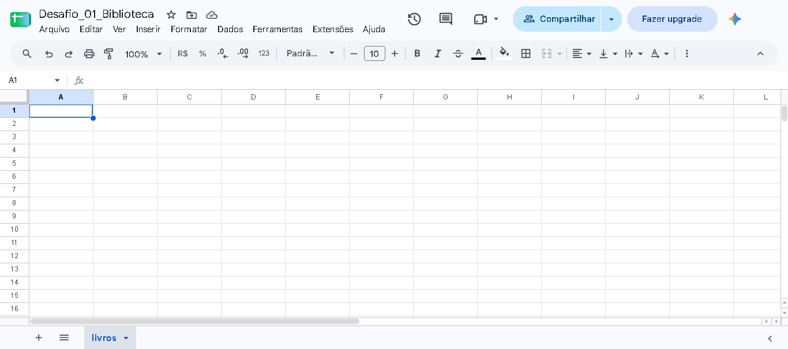

<br />

> [!WARNING]
>
> ### Biblioteca Pública não é um tema
>
> A imagem acima, com o tema **Biblioteca Pública**, foi criada apenas para ilustrar a tarefa e desenvolvida de forma semelhante aos 8 temas propostos.

<br />

3. Clique no botão **Compartilhar** da planilha, cole o `client_email` copiado no passo 1, defina o papel como **Editor**, desmarque a opção **notificar pessoas** e clique no botão **Compartilhar**.

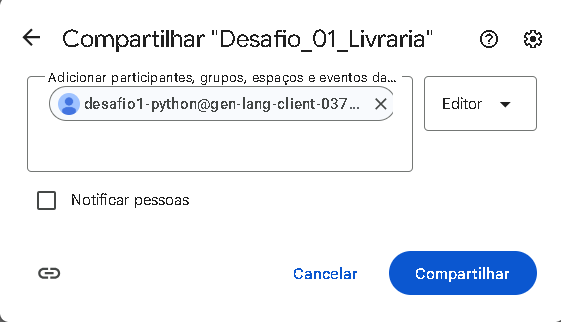

4. Copie o **ID da planilha** na barra de endereços: é o trecho do link da planilha entre **/d/** e **/edit**, como mostra a imagem abaixo:

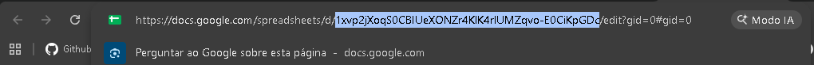

<br />

> [!WARNING]
>
> ### Sem compartilhar a planilha, a escrita falha em silêncio
>
> Confira se o e-mail da credencial aparece na lista de pessoas com acesso. Esse é o erro mais comum que acontece nesta prática.

<br />

---

## 👣Passo 6 — Abrir o Google Colab e autenticar

1.  Acesse [**colab.research.google.com**](https://colab.research.google.com) e crie um novo notebook (Arquivo → Novo notebook).

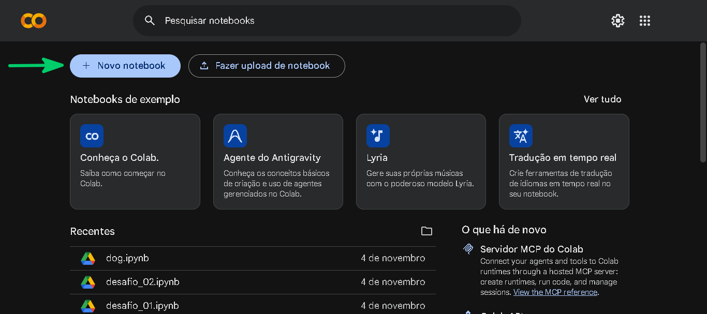

2.  Renomeie para **Desafio1_API_Python**.

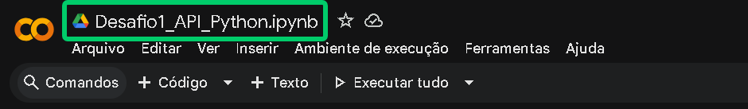

3.  No painel esquerdo do Google Colab, abra o ícone de chave (**Secrets**) **→ Adicionar novo secret**.

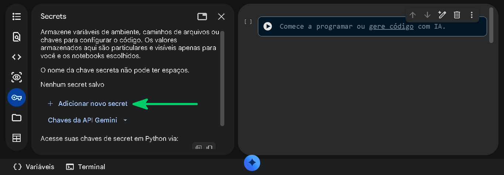

4.  Defina os seguintes parâmetros: 
    - **Nome:** `GCP_SA_JSON`
    - **Valor:** o **conteúdo inteiro** do arquivo JSON (selecione todo o conteúdo do arquivo, copie e cole). 

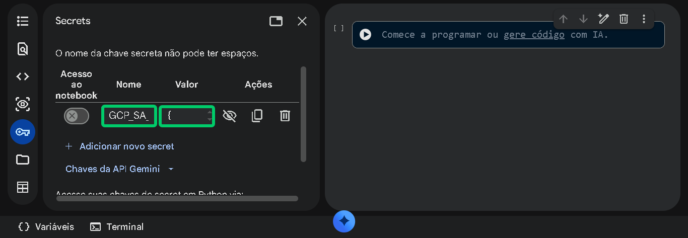

5.  Clique novamente em **Adicionar novo secret**.
6.  Defina os seguintes parâmetros: 
    - **Nome:** `GS_ID`
    - **Valor:** Cole o **ID da planilha**, que foi copiado no passo anterior.

<div align="center"></div>

7. Ao concluir, feche este painel, clicando no **X** 

---

## 👣Passo 6B — Escrever o script Python no Colab


1. Cole as células abaixo, uma em cada célula de código, e execute uma a uma (**Shift + Enter**).

<br />

> [!TIP]
>
> Antes de cada célula de código, adicione uma célula de texto para identificar o que cada uma faz. Use como base a explicação que aparece acima de cada célula neste guia.

<br />

### Célula 01 · Instalar as bibliotecas gspread e faker

**O que esta célula faz:** instala no ambiente do Colab as duas bibliotecas externas que vamos usar.

- **gspread:** biblioteca Python que facilita o acesso ao Google Sheets pela API. Com poucas linhas, você abre uma planilha e lê ou escreve valores em células e linhas, sem montar as requisições HTTP manualmente.
- **Faker:** biblioteca que gera dados fictícios com aparência realista (nomes, endereços, e-mails, datas, textos etc.), inclusive em português do Brasil. É ela que permite montar uma base *mockada (dados fictícios)* sem usar dados de pessoas reais.

A instalação vale apenas para a sessão atual do Colab. Se o ambiente for reiniciado ou desconectado, execute esta célula novamente.

``` python
# Instala as duas bibliotecas externas usadas neste notebook:
#   gspread -> acessa e edita planilhas do Google Sheets pela API
#   faker   -> gera dados fictícios (nomes, datas, endereços etc.)
# O "!" executa o comando no terminal do Colab; o "-q" reduz as mensagens exibidas.
!pip install -q gspread faker
```

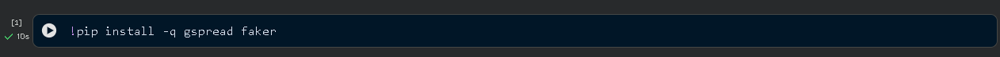

---

### Célula 02 · Importações e Autenticação (service account)

**O que esta célula faz:** importa as bibliotecas e autentica o Python no Google com a service account, a "conta robô" criada no Passo 1. O conteúdo do arquivo JSON da credencial é lido da Secret `GCP_SA_JSON` do Colab, portanto nunca fica escrito no código. Com ele, o gspread cria a conexão (`gc`) que será usada nas próximas células. Se tudo der certo, aparece o `client_email` da credencial.

``` python
# Bibliotecas usadas ao longo do notebook.
import json, gspread, random, os, time
from faker import Faker
import pandas as pd

from google.colab import files
# O userdata dá acesso às Secrets do Colab (credencial e ID da planilha).
from google.colab import userdata

# Lê o conteúdo do JSON da credencial (Secret GCP_SA_JSON) e converte o texto em dicionário.
info = json.loads(userdata.get("GCP_SA_JSON"))

# Cria o cliente do gspread autenticado com a service account.
gc = gspread.service_account_from_dict(info)

# Exibe o e-mail da credencial para confirmar que a autenticação funcionou.
print("Conectado como:", info["client_email"])
```

<br />

> [!NOTE]
>
> 1.  Ao executar esta célula pela primeira vez, será necessário autorizar o notebook a acessar a secret **GCP_SA_JSON**, como vemos na imagem abaixo. Clique no botão **Permitir acesso**
>
> 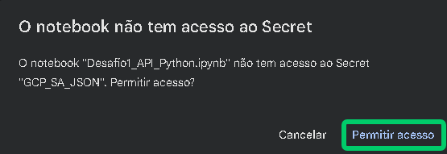
>
> 2.  Execute novamente a célula 02 e verifique se a conexão foi bem-sucedida (será exibido o **client_email**)
>
> 
>

---

### Célula 03 · Abrir a planilha

**O que esta célula faz:** abre a planilha criada no Passo 5 a partir do ID guardado na Secret `GS_ID`, seleciona a primeira aba e a renomeia com o nome da tabela dimensão do seu tema. Ao final, imprime o título da planilha, o nome da aba e o link, o que confirma que o acesso funciona.

``` python
# Lê o ID da planilha guardado na Secret GS_ID (copiado no Passo 5).
SHEET_ID = userdata.get("GS_ID")

# Define o nome que a aba da planilha vai receber.
NOME_TABELA = "nome_da_tabela"   # nome da tabela dimensão do seu tema (veja a tabela abaixo)

# Abre a planilha pelo ID e seleciona a primeira aba (ws será usada nas próximas células).
sh = gc.open_by_key(SHEET_ID)
ws = sh.sheet1

# Renomeia a aba com o nome da tabela e exibe os dados da planilha.
ws.update_title(NOME_TABELA)     # a aba passa a ter o nome da tabela
print(sh.title, "|", ws.title, "|", sh.url)
```

<br />

> [!NOTE]
>
> 1.  Na constante **NOME_TABELA**, adicione o nome da tabela dimensão do seu projeto, conforme a tabela abaixo:
>
> | \#   | Tema                   | Pasta                     | Dimensão  | Fato               |
> | ---- | ---------------------- | ------------------------- | --------- | ------------------ |
> | 1    | Estacionamento         | 01-estacionamento         | vagas     | movimentacoes      |
> | 2    | Posto de Saúde         | 02-posto-de-saude         | pacientes | atendimentos       |
> | 3    | Streaming de filmes    | 03-streaming-de-filmes    | filmes    | visualizacoes      |
> | 4    | Atendimento ao cliente | 04-atendimento-ao-cliente | clientes  | chamados           |
> | 5    | Passagens aéreas       | 05-passagens-aereas       | voos      | reservas           |
> | 6    | Serviço meteorológico  | 06-servico-meteorologico  | estacoes  | leituras           |
> | 7    | Telemetria esportiva   | 07-telemetria-esportiva   | pilotos   | voltas             |
> | 8    | Festival de música     | 08-festival-de-musica     | atracoes  | ingressos_vendidos |
>
> 2. Se aparecer o título da sua planilha, a autenticação funcionou.
>
> 
>
> 3. Observe que o nome da planilha no Google Sheets também foi modificado:
>
> 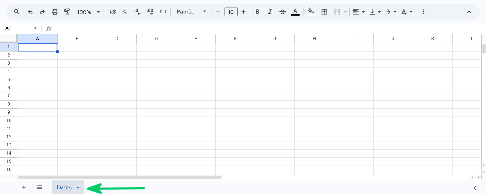
>

---

## 👣Passo 7 — Escrever o cabeçalho do esquema


Defina a lista de colunas **uma única vez** e reutilize-a em todo o código. Os nomes vêm da ficha do tema, **sem nenhuma alteração**. Todos os temas possuem duas tabelas, portanto vamos começar pela primeira delas, a tabela **dimensão**. É nela que você vai escrever o cabeçalho e as 10 linhas de teste nesta prática.


### Célula 04 · Cabeçalho – Tabela Dimensão

**O que esta célula faz:** define a lista `COLUNAS` com os nomes das colunas da tabela dimensão e a escreve na linha 1 da planilha, formando o cabeçalho. Essa lista é declarada uma única vez e reutilizada na Célula 05 e na conferência. Por fim, a célula lê a linha 1 de volta e compara com a lista para confirmar que o cabeçalho foi gravado corretamente.

``` python
# Substitua pelos nomes EXATOS de coluna da ficha do seu tema, na mesma ordem do plano.
# Esta lista define o cabeçalho e a ordem dos valores que serão enviados na Célula 05.
COLUNAS = ["coluna_1", "coluna_2", "coluna_3"]

# Escreve o cabeçalho a partir da célula A1.
# O parâmetro "values" recebe uma lista de linhas; como o cabeçalho é uma única linha, usamos [COLUNAS].
ws.update(range_name="A1", values=[COLUNAS])

# Lê a linha 1 de volta e compara com COLUNAS: True indica que o cabeçalho foi gravado corretamente.
print("Cabeçalho confere:", ws.row_values(1) == COLUNAS)
```

<br />

> [!IMPORTANT]
>
> ### O esquema é fixo
>
> Usar o nome errado de coluna (por exemplo, duracao_minutos no lugar de duracao_min) é um erro sutil: só aparece quando alguém compara com atenção o que o plano define com o que o código escreve. Rodar o script e assumir que funcionou não basta.

<br />

> [!NOTE]
>
> 1.  Observe na planilha que a primeira linha foi preenchida com os nomes dos atributos da tabela dimensão
>
> 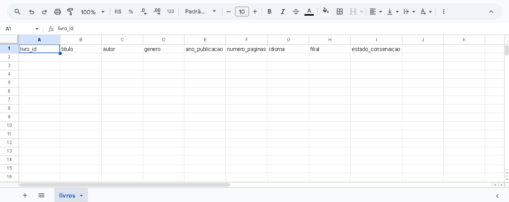
>

---

## 👣Passo 8 — Gerar e escrever 10 linhas de teste


Gere 10 linhas de dado mockado para a tabela **dimensão**, seguindo o esquema do tema. Lembre-se das regras do passo 4: dado **fictício**, nada que lembre uma pessoa real e registro de qualquer trecho gerado com IA.


### Célula 05 · 10 linhas de teste – Tabela Dimensão

**O que esta célula faz:** gera 10 linhas de dados fictícios para a tabela dimensão e as acrescenta na planilha, logo abaixo do cabeçalho. A parte que **você** precisa construir é a função `gerar_linha(i)`: ela devolve **um registro**, e cada chave do dicionário deve ter o nome exato de uma coluna da lista `COLUNAS`. O restante do código (gerar os 10 registros, ordenar os valores conforme o cabeçalho e enviar para a planilha) já está pronto.

Dentro da função, você encontra **exemplos de estrutura** para os principais tipos de coluna (identificadores, categorias, números, datas, horas, textos, nomes, lugares e valores que dependem de outra coluna). Eles são genéricos: **nenhum deles indica qual coluna ou qual tema usa o quê**. Essa escolha vem do plano do seu tema.

> [!TIP]
>
> 1. ### Como montar a função `gerar_linha`
>
>    1. **Leia a documentação do seu tema** e anote, para cada coluna da tabela dimensão, o tipo, o formato e as regras ou valores permitidos.
>    2. **Crie uma chave para cada coluna** da lista de `COLUNAS`, com o mesmo nome. Se faltar uma chave, o Python acusa `KeyError`; se sobrar uma, ela é ignorada e você não percebe.
>    3. **Escolha o gerador conforme o tipo da coluna**, olhando os exemplos do código: copie a linha parecida, troque o nome da chave pelo nome da sua coluna e ajuste os valores. 
>    4. **Apague os exemplos que não serão utilizados**.
>    5. **Respeite o formato do plano:** número como número, data como texto, sem alterar maiúsculas ou grafia dos valores permitidos.
>    6. **Aplique as regras na geração**, e não depois, na planilha. Quando uma coluna depende de outra, sorteie a coluna "de origem" primeiro, guarde em uma variável (como `grupo`, `par` e `inicio` no código) e use essa variável nas demais.
>    7. **Teste antes de enviar:** descomente o `print(linhas[0])` do código e compare o resultado com o plano.
>    8. **Lembre-se das regras do Passo 4:** dados fictícios, nada que lembre uma pessoa real e registro de qualquer trecho gerado com IA.

<br />

### Tipos de exemplo que o código traz

| Grupo                                | Exemplos no código (`coluna_1` em diante)                    |
| :----------------------------------- | :----------------------------------------------------------- |
| Identificadores e códigos            | sequencial, código com prefixo e zeros à esquerda            |
| Categorias                           | lista com a mesma chance, lista com pesos (as opções podem ser texto ou número) |
| Números                              | inteiro em faixa, decimal em faixa                           |
| Datas e horas                        | data em intervalo, data somada a dias (o mesmo vale para minutos), data e hora em intervalo, horário `HH:MM` |
| Textos, nomes e lugares              | nome completo, sobrenome, palavra, bairro, cidade            |
| Valores que dependem de outra coluna | valor associado a uma categoria (dicionário), dois valores diferentes da mesma lista |

Cada função aparece **uma única vez**. Para montar casos mais elaborados, combine os exemplos (por exemplo, sortear uma categoria com `random.choice` e buscar o valor dela em um dicionário).

> [!WARNING]
>
> Os nomes do Faker são combinações aleatórias e **podem coincidir com pessoas reais por acaso**. Use-os só como dado de teste, não associe a ninguém e registre no seu código o que foi gerado com IA.

<br />

``` python
from datetime import date, timedelta

# Cria o gerador do Faker em português do Brasil (nomes, cidades e datas no padrão brasileiro).
fake = Faker("pt_BR")

# Fixa as sementes (seeds): a cada execução os valores aleatórios saem iguais,
# o que torna o resultado reproduzível e mais fácil de conferir.
Faker.seed(42)
random.seed(42)

def gerar_linha(i):
    # Devolve UM registro fictício, no formato {nome_da_coluna: valor}.
    # "i" é o número da linha (1 a 10) e pode servir de identificador sequencial.
    # ATENÇÃO: as chaves precisam ser exatamente os nomes de COLUNAS (Célula 04).
    # Tudo abaixo são apenas EXEMPLOS de estrutura: substitua pelas colunas
    # e pelos geradores adequados ao tipo de cada coluna do seu tema, e apague o que não usar.

    # --- Valores que outras colunas vão reaproveitar (sorteie a coluna de origem UMA vez) ---
    grupo = random.choice(["g1", "g2", "g3"])                                  # categoria de origem
    par = random.sample(["x", "y", "z", "w"], 2)                               # dois valores DIFERENTES da mesma lista
    inicio = fake.date_between(start_date=date(2020, 1, 1), end_date=date(2024, 12, 31))   # data de origem

    return {
        "coluna_1": i,                                                         # ex.: identificador sequencial
        "coluna_2": f"ABC-{i:05d}",                                            # ex.: código com prefixo e zeros à esquerda (ABC-00001)
        "coluna_3": random.choice(["A", "B", "C"]),                            # ex.: categoria com valores definidos (mesma chance)
        "coluna_4": random.choices(["A", "B", "C"], weights=[70, 20, 10])[0],  # ex.: categoria com pesos (70%, 20%, 10%); as opções também podem ser números
        "coluna_5": random.randint(1, 100),                                    # ex.: inteiro em uma faixa (extremos incluídos)
        "coluna_6": round(random.uniform(0.5, 9.5), 2),                        # ex.: decimal em uma faixa, com 2 casas
        "coluna_7": inicio.isoformat(),                                        # ex.: data em um intervalo, guardada como texto (AAAA-MM-DD)
        "coluna_8": (inicio + timedelta(days=2)).isoformat(),                  # ex.: data derivada de outra (origem + 2 dias); timedelta também aceita minutes=, hours=
        "coluna_9": fake.date_time_between(start_date=date(2025, 1, 1), end_date=date(2025, 12, 31)).strftime("%Y-%m-%d %H:%M:%S"),   # ex.: data e hora em um intervalo (AAAA-MM-DD HH:MM:SS)
        "coluna_10": fake.time(pattern="%H:%M"),                               # ex.: horário guardado como texto (HH:MM)
        "coluna_11": fake.name(),                                              # ex.: nome completo fictício
        "coluna_12": fake.last_name(),                                         # ex.: só o sobrenome
        "coluna_13": fake.word().capitalize(),                                 # ex.: palavra solta, com a primeira letra maiúscula
        "coluna_14": fake.bairro(),                                            # ex.: bairro
        "coluna_15": fake.city(),                                              # ex.: cidade
        "coluna_16": {"g1": "valor_1", "g2": "valor_2", "g3": "valor_3"}[grupo],   # ex.: valor associado à categoria de origem (dicionário)
        "coluna_17": par[0],                                                   # ex.: primeiro de dois valores diferentes (use par[1] para o segundo)
    }

# Chama a função 10 vezes (i = 1, 2, ..., 10) e guarda os registros em uma lista.
linhas = [gerar_linha(i) for i in range(1, 11)]

# Dica: descomente a linha abaixo para conferir o primeiro registro antes de enviar.
# print(linhas[0])

# Converte cada registro em uma lista de valores NA ORDEM de COLUNAS (a ordem do cabeçalho).
# Se uma chave faltar ou tiver nome diferente, o Python acusa KeyError.
valores = [[linha[c] for c in COLUNAS] for linha in linhas]

# Acrescenta as 10 linhas após a última linha preenchida da planilha.
# O modo "RAW" grava os valores exatamente como estão, sem o Sheets reinterpretá-los.
ws.append_rows(valores, value_input_option="RAW")
print(len(valores), "linhas enviadas")
```

<br />

> [!IMPORTANT]
>
> Ajuste `gerar_linha` para devolver exatamente as colunas e os tipos do seu tema. A estrutura `[linha[c] for c in COLUNAS]` acusa na hora um nome de coluna diferente do esquema.

<br />

> [!WARNING]
>
> ### Execute a Célula 05 apenas uma vez
>
> Se você executá-la novamente, as 10 linhas serão acrescentadas outra vez e a planilha ficará com linhas duplicadas, e a Célula 06 não mostrará o valor esperado (11). Se isso acontecer, apague na planilha as linhas duplicadas, da linha 12 em diante.

<br />

> [!NOTE]
>
> 1.  Observe na planilha que da linha 2 até a linha 11, foram preenchidas com dados gerados pela biblioteca Faker
>
> 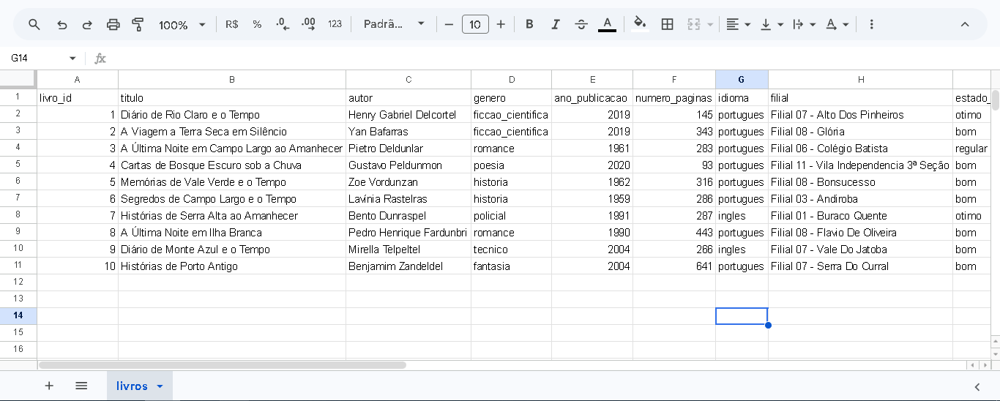
>

---

## 👣Passo 9 — Conferir o resultado na planilha

Executar sem erro prova que o código rodou, não que o dado chegou. **Leia de volta** o que está na planilha:


### Célula 06 · Conferência – Tabela Dimensão

**O que esta célula faz:** lê de volta tudo o que está na aba e confere o resultado: o total de linhas (esperado: 11, sendo 1 de cabeçalho e 10 de dados), se o cabeçalho é igual a `COLUNAS` e uma amostra das primeiras linhas.

``` python
# Lê todos os valores da aba (lista de linhas) para conferir o que realmente chegou à planilha.
valores_lidos = ws.get_all_values()

# Quantidade de linhas: cabeçalho + 10 linhas de dados.
print("Linhas (cabeçalho + dados):", len(valores_lidos))    # esperado: 11

# A primeira linha lida (índice 0) deve ser igual à lista COLUNAS.
print("Cabeçalho confere:", valores_lidos[0] == COLUNAS)

# Mostra as 3 primeiras linhas (cabeçalho + 2 registros) para uma conferência rápida.
print(valores_lidos[:3])
```

<br />

> [!NOTE]
>
> Depois **abra a planilha no navegador** e confirme visualmente: cabeçalho na linha 1, 10 linhas de dados abaixo, colunas com os nomes certos e nenhum dado que lembre uma pessoa real. Ao final, mostre a planilha ao instrutor.

<br />

---

<table width="100%">
  <tr>
    <td align="left" width="33%"><a href="Guia_Desafio1_Google_Colab.md">← Parte 1</a></td>
    <td align="center" width="34%"><a href="../README.md">README</a></td>
    <td align="right" width="33%"><a href="Guia_Desafio1_Google_Colab_Parte3.md">Avançar → Parte 3</a></td>
  </tr>
</table>