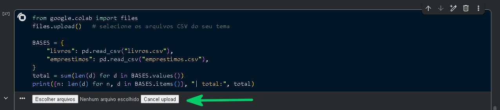
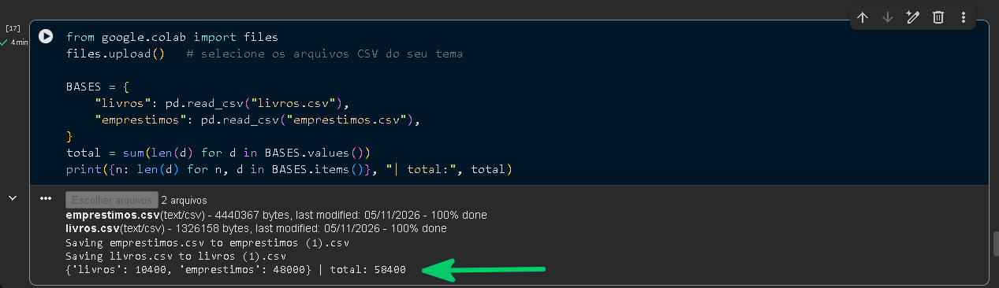
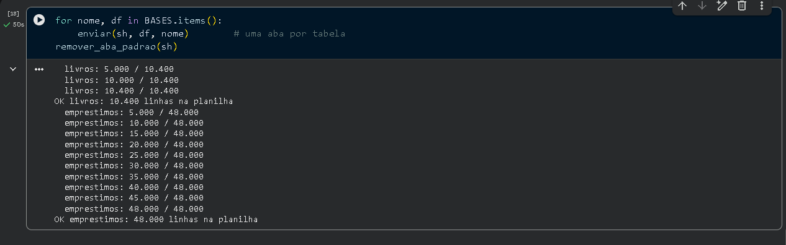
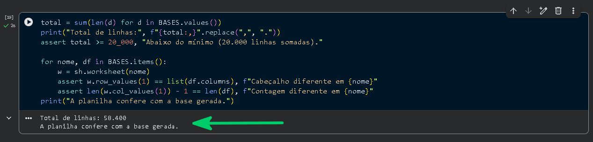
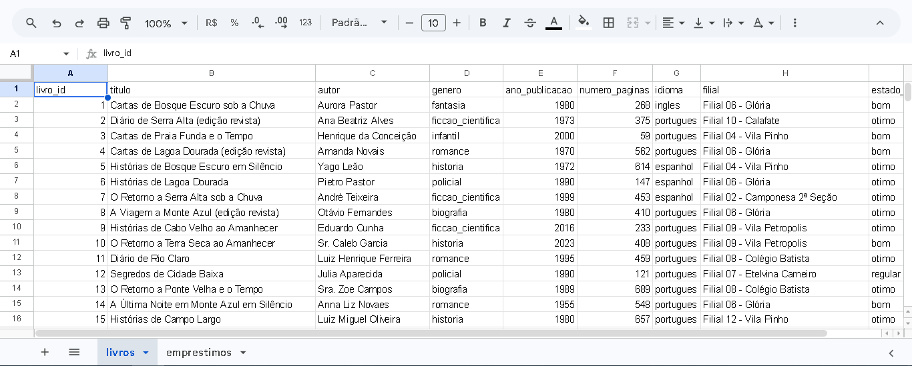

# Guia do Desafio 01 · Analista de Dados

<div align="center"></div>

**Parte 3 de 3 — Depois da sessão e referências**

<table width="100%">
  <tr>
    <td align="left" width="33%"><a href="Guia_Desafio1_Google_Colab_Parte2.md">← Parte 2</a></td>
    <td align="center" width="34%"><a href="../README.md">README</a></td>
    <td align="right" width="33%"><strong>Fim do guia</strong></td>
  </tr>
</table>

---

# Sessão Assíncrona — Prática

**Objetivo:** concluir a entrega no mesmo notebook da sessão síncrona. Você vai registrar 10 linhas de teste na tabela **fato**, carregar a base completa do seu tema na planilha e, como desafio, gerar a sua própria base grande e exportá-la em arquivos CSV.

| **Etapa** | **O que você faz**                                                          | **Passos**   |
| --------- | --------------------------------------------------------------------------- | ------------ |
| 1         | Gerar e escrever 10 linhas de teste na tabela fato (segunda guia)           | 10           |
| 2         | Carregar a base completa disponível no repositório e enviar para a planilha | 11 a 13      |
| 3         | **Desafio:** gerar a base grande com Python e exportá-la em CSV             | Desafio      |
| 4         | Registrar o uso de IA e entregar no Canvas                                  | 14 e 15      |

<br />

---

## 👣Passo 10 — Gerar e escrever 10 linhas de teste na tabela fato

A tabela **fato** guarda os eventos do seu tema (movimentações, atendimentos, visualizações etc.) e **referencia a tabela dimensão por uma chave estrangeira**. As células deste passo repetem a lógica das **Células 04, 05 e 06** da Parte 2, agora para a tabela fato e na **segunda guia** da planilha:

| **Célula (Parte 3)**             | **Repete a lógica da** | **O que faz**                                                    |
| -------------------------------- | ---------------------- | ---------------------------------------------------------------- |
| 07 · Cabeçalho – Tabela Fato     | Célula 04              | Cria a segunda guia e escreve o cabeçalho                        |
| 08 · 10 linhas de teste – Fato   | Célula 05              | Gera e escreve 10 linhas, com chave estrangeira válida           |
| 09 · Conferência – Tabela Fato   | Célula 06              | Lê de volta e confere linhas, cabeçalho e chave estrangeira      |

Use o mesmo notebook, continuando depois da Célula 06. O nome da tabela fato do seu tema está na tabela abaixo.

|                                                              | \#   | Tema                   | Pasta                     | Dimensão  | Fato               |
| ------------------------------------------------------------ | ---- | ---------------------- | ------------------------- | --------- | ------------------ |
|  | 1    | Estacionamento         | 01-estacionamento         | vagas     | movimentacoes      |
|  | 2    | Posto de Saúde         | 02-posto-de-saude         | pacientes | atendimentos       |
|  | 3    | Streaming de filmes    | 03-streaming-de-filmes    | filmes    | visualizacoes      |
|  | 4    | Atendimento ao cliente | 04-atendimento-ao-cliente | clientes  | chamados           |
|  | 5    | Passagens aéreas       | 05-passagens-aereas       | voos      | reservas           |
|  | 6    | Serviço meteorológico  | 06-servico-meteorologico  | estacoes  | leituras           |
|  | 7    | Telemetria esportiva   | 07-telemetria-esportiva   | pilotos   | voltas             |
|  | 8    | Festival de música     | 08-festival-de-musica     | atracoes  | ingressos_vendidos |

<br />

### Célula 07 · Cabeçalho – Tabela Fato

**O que esta célula faz:** define o nome e a lista de colunas da tabela fato, cria a **segunda guia** da planilha com o nome da tabela e escreva o cabeçalho na linha 1. Ao final, lê a linha 1 de volta e compara com a lista para confirmar que o cabeçalho foi gravado corretamente. Se a guia já existir (por exemplo, ao executar a célula de novo), ela é reaproveitada e limpa.

``` python
# Nome da tabela fato do seu tema (veja a tabela acima). Ele será o nome da segunda guia.
NOME_TABELA_FATO = "nome_da_tabela_fato"

# Substitua pelos nomes EXATOS de coluna da tabela fato, na mesma ordem do plano.
# Esta lista define o cabeçalho e a ordem dos valores enviados nas Células 08 e 09.
COLUNAS_FATO = ["coluna_1", "coluna_2", "coluna_3"]

# Reaproveita a guia se ela já existir (limpando o conteúdo) ou cria a segunda guia da planilha.
try:
    ws_fato = sh.worksheet(NOME_TABELA_FATO)
    ws_fato.clear()
except gspread.WorksheetNotFound:
    ws_fato = sh.add_worksheet(title=NOME_TABELA_FATO, rows=100, cols=len(COLUNAS_FATO))

# Escreve o cabeçalho a partir da célula A1 e lê a linha 1 de volta para conferir.
ws_fato.update(range_name="A1", values=[COLUNAS_FATO])
print("Cabeçalho confere:", ws_fato.row_values(1) == COLUNAS_FATO)

# Exibe planilha, guia e link para confirmar que a escrita foi na guia certa.
print(sh.title, "|", ws_fato.title, "|", sh.url)
```

<br />

> [!NOTE]
>
> A variável `ws` continua apontando para a guia da **tabela dimensão**, e `ws_fato` aponta para a nova guia, da **tabela fato**. Observe na planilha que surgiu a segunda guia, com o cabeçalho preenchido.

<br />

---

### Célula 08 · 10 linhas de teste – Tabela Fato

**O que esta célula faz:** gera 10 linhas de dados fictícios para a tabela fato e as acrescenta na segunda guia, abaixo do cabeçalho. Funciona como a **Célula 05**: a parte que **você** constrói é a função `gerar_linha_fato(i)`, que devolve **um registro**, com uma chave para cada nome de `COLUNAS_FATO`. O restante já está pronto.

A novidade em relação à tabela dimensão é o **relacionamento**: a chave estrangeira precisa apontar para um ID que **existe** na tabela dimensão. Por isso a célula começa lendo da planilha os IDs já gravados na guia da dimensão e sorteia a chave estrangeira apenas entre eles.

> [!TIP]
>
> ### Como montar a função `gerar_linha_fato`
>
> 1. **Leia a documentação do seu tema** e anote, para cada coluna da tabela **fato**, o tipo, o formato e as regras ou valores permitidos.
> 2. **Crie uma chave para cada coluna** de `COLUNAS_FATO`, com o mesmo nome.
> 3. **Reaproveite os exemplos da Célula 05** (categorias, números, datas, textos) e copie a linha parecida com o tipo de cada coluna. O código abaixo traz apenas os exemplos que são **novos** na tabela fato.
> 4. **Chave estrangeira:** use sempre `random.choice(ids_dimensao)`. Nunca invente um ID.
> 5. **Valores que dependem de outros:** sorteie os valores de origem primeiro, guarde em variáveis e calcule a coluna a partir delas.
> 6. **Apague os exemplos que não serão utilizados** e teste com `print(linhas[0])` antes de enviar.
> 7. **Lembre-se das regras do Passo 4:** dados fictícios, nada que lembre uma pessoa real e registro de qualquer trecho gerado com IA.

<br />

``` python
from datetime import date

# Reinicia as sementes: o resultado fica reproduzível e fácil de conferir.
Faker.seed(42)
random.seed(42)

# IDs que EXISTEM na tabela dimensão: coluna 1 da primeira guia, sem o cabeçalho.
ids_dimensao = [int(v) for v in ws.col_values(1)[1:]]

def gerar_linha_fato(i):
    # Devolve UM registro fictício, no formato {nome_da_coluna: valor}.
    # ATENÇÃO: as chaves precisam ser exatamente os nomes de COLUNAS_FATO (Célula 07).
    # Os exemplos abaixo são apenas ESTRUTURA: substitua pelas colunas do seu tema
    # e use também os exemplos da Célula 05 para os demais tipos de coluna.

    # --- Valores de origem, reaproveitados em colunas calculadas ---
    base = random.randint(1, 5)
    fator = round(random.uniform(10, 100), 2)

    return {
        "coluna_1": i,                                                         # ex.: identificador sequencial
        "coluna_2": random.choice(ids_dimensao),                               # ex.: CHAVE ESTRANGEIRA: um ID que existe na tabela dimensão
        "coluna_3": fake.date_time_between(start_date=date(2025, 1, 1), end_date=date(2025, 12, 31)).strftime("%Y-%m-%d %H:%M:%S"),   # ex.: data e hora em um intervalo
        "coluna_4": base,                                                      # ex.: valor de origem sorteado
        "coluna_5": round(base * fator, 2),                                    # ex.: valor calculado a partir de outros (base × fator)
        "coluna_6": random.random() < 0.8,                                     # ex.: verdadeiro ou falso (80% de chance de True)
    }

# Chama a função 10 vezes (i = 1, 2, ..., 10) e guarda os registros em uma lista.
linhas = [gerar_linha_fato(i) for i in range(1, 11)]

# Dica: descomente a linha abaixo para conferir o primeiro registro antes de enviar.
# print(linhas[0])

# Converte cada registro em uma lista de valores NA ORDEM de COLUNAS_FATO (a ordem do cabeçalho).
# Se uma chave faltar ou tiver nome diferente, o Python acusa KeyError.
valores = [[linha[c] for c in COLUNAS_FATO] for linha in linhas]

# Acrescenta as 10 linhas na guia da tabela fato, após a última linha preenchida.
ws_fato.append_rows(valores, value_input_option="RAW")
print(len(valores), "linhas enviadas")
```

<br />

> [!WARNING]
>
> ### Execute a Célula 08 apenas uma vez
>
> Se você executá-la novamente, as 10 linhas serão acrescentadas outra vez e a Célula 09 não mostrará o valor esperado (11). Para recomeçar, execute a Célula 07 de novo (ela limpa a guia) e depois a Célula 08.

<br />

---

### Célula 09 · Conferência – Tabela Fato

**O que esta célula faz:** lê de volta tudo o que está na segunda guia e confere o total de linhas (esperado: 11, sendo 1 de cabeçalho e 10 de dados), o cabeçalho e uma amostra. Além disso, verifica o **relacionamento**: toda chave estrangeira da tabela fato deve existir na tabela dimensão.

``` python
# Lê todos os valores da guia da tabela fato para conferir o que realmente chegou à planilha.
valores_fato = ws_fato.get_all_values()

# Quantidade de linhas: cabeçalho + 10 linhas de dados.
print("Linhas (cabeçalho + dados):", len(valores_fato))    # esperado: 11

# A primeira linha lida deve ser igual à lista COLUNAS_FATO.
print("Cabeçalho confere:", valores_fato[0] == COLUNAS_FATO)

# Mostra as 3 primeiras linhas (cabeçalho + 2 registros) para uma conferência rápida.
print(valores_fato[:3])

# Informe aqui o nome da coluna que é chave estrangeira (a que referencia a tabela dimensão).
COLUNA_FK = COLUNAS_FATO.index("coluna_2")

# Todo ID usado na tabela fato precisa existir na coluna 1 da tabela dimensão.
ids_usados = {linha[COLUNA_FK] for linha in valores_fato[1:]}
ids_existentes = set(ws.col_values(1)[1:])
print("Chaves estrangeiras válidas:", ids_usados <= ids_existentes)   # esperado: True
```

<br />

> [!NOTE]
>
> Depois **abra a planilha no navegador** e confirme visualmente: duas guias (dimensão e fato), cabeçalho na linha 1 de cada uma, 10 linhas de dados na tabela fato e nenhum dado que lembre uma pessoa real. A tabela dimensão continua com as 10 linhas da sessão síncrona.

<br />

---

## 👣Passo 11 — Carregar a base completa do repositório

O repositório do Desafio traz a **base pronta de cada tema**: dois arquivos CSV, um por tabela, com os nomes de coluna da ficha e volume acima do mínimo (entre 52 mil e 72 mil linhas somadas). Neste passo você carrega esses arquivos no notebook; nos passos 12 e 13 eles são enviados para a planilha e validados.

Primeiro, as funções de envio (reutilizadas nos passos 12 e 13):

### Célula 10 · Funções de envio de dados - Planilha

**O que esta célula faz:** define as funções que convertem uma tabela do `pandas` em valores aceitos pela planilha e a enviam em lotes, conferindo ao final a contagem de linhas.

``` python
# Importa recursos para controlar pausas, acessar a planilha e tratar tabelas.
import time
import gspread
import pandas as pd
 
def df_para_valores(df):
    """DataFrame -> lista de listas com tipos nativos do Python."""
    # Trabalha em uma cópia para não alterar o DataFrame original.
    df = df.copy()
    for c in df.columns:
        # Converte datas para texto em um formato padronizado.
        if pd.api.types.is_datetime64_any_dtype(df[c]):
            df[c] = df[c].dt.strftime("%Y-%m-%d %H:%M:%S")
        # Converte outros valores de data e hora para texto.
        elif df[c].dtype == object:
            df[c] = df[c].map(
                lambda v: v.isoformat() if hasattr(v, "isoformat") else v)
    # Substitui valores ausentes por texto vazio e retorna linhas de valores.
    return df.astype(object).where(df.notna(), "").values.tolist()
 
def enviar(sh, df, nome_aba, lote=5000, pausa=2):
    """Escreve cabeçalho e linhas numa aba, em lotes, e confere a contagem."""
    # Formata números com ponto como separador de milhar.
    n = lambda x: f"{x:,}".replace(",", ".")
    try:
        # Reutiliza a aba existente e apaga seu conteúdo anterior.
        ws = sh.worksheet(nome_aba)
        ws.clear()
    except gspread.WorksheetNotFound:
        # Cria uma aba caso ela ainda não exista.
        ws = sh.add_worksheet(title=nome_aba, rows=len(df) + 1,
                              cols=len(df.columns))
    # Ajusta o tamanho da aba e grava os nomes das colunas.
    ws.resize(rows=len(df) + 1, cols=len(df.columns))
    ws.update(range_name="A1", values=[list(df.columns)])
    # Converte o DataFrame e envia as linhas em lotes.
    valores = df_para_valores(df)
    for i in range(0, len(valores), lote):
        ws.append_rows(valores[i:i + lote], value_input_option="RAW")
        print(f"  {nome_aba}: {n(min(i + lote, len(valores)))} / {n(len(valores))}")
        time.sleep(pausa)               # respeita o limite de escritas/minuto
    # Confere se a quantidade de linhas gravadas corresponde à esperada.
    lidas = len(ws.col_values(1)) - 1   # lê de volta e confere
    if lidas != len(df):
        raise RuntimeError(f"Aba {nome_aba}: enviei {len(df)}, li {lidas}.")
    print(f"OK {nome_aba}: {n(len(df))} linhas na planilha")
 
def remover_aba_padrao(sh):
    """Apaga a aba vazia que o Google cria junto com a planilha nova."""
    # Localiza e remove a aba padrão somente se houver outra aba disponível.
    abas = sh.worksheets()
    padrao = ("Página1", "Sheet1", "Planilha1")
    for w in abas:
        if w.title in padrao and len(abas) > 1 and not w.get_all_values():
            sh.del_worksheet(w)
```

<br />

### Célula 11 · Carregar as bases de dados prontas

**O que esta célula faz:** abre a janela de seleção de arquivos do Colab para você enviar os 2 CSV do seu tema, carrega cada um em um `DataFrame` e confere se as colunas são as mesmas dos cabeçalhos que você definiu nas Células 04 e 07. Os arquivos têm o **mesmo nome das tabelas**, então não há nada para editar: a célula usa as variáveis `NOME_TABELA` e `NOME_TABELA_FATO`.

``` python
# Abre a opção de selecionar arquivos CSV no Colab e envia os arquivos.
from google.colab import files
files.upload()   # selecione os 2 arquivos CSV do seu tema

# Carrega cada CSV em um DataFrame. O arquivo tem o mesmo nome da tabela (Células 03 e 07).
BASES = {
    NOME_TABELA: pd.read_csv(f"{NOME_TABELA}.csv"),
    NOME_TABELA_FATO: pd.read_csv(f"{NOME_TABELA_FATO}.csv"),
}

# Confere se as colunas dos CSV seguem os cabeçalhos definidos nas Células 04 e 07.
assert list(BASES[NOME_TABELA].columns) == COLUNAS, f"Colunas diferentes em {NOME_TABELA}"
assert list(BASES[NOME_TABELA_FATO].columns) == COLUNAS_FATO, f"Colunas diferentes em {NOME_TABELA_FATO}"

# Calcula e exibe a quantidade de linhas carregadas.
total = sum(len(d) for d in BASES.values())
print({n: len(d) for n, d in BASES.items()}, "| total:", total)
```

<br />

1.  Acesse o repositório do Desafio (o mesmo link do Passo 3, na Parte 1), abra a pasta do seu tema e **baixe os 2 arquivos CSV** (botão **Download raw file**). Os nomes dos arquivos são os da tabela abaixo:

|                                                              | \#   | Base (pasta)              | CSV da dimensão | CSV do fato            |
| ------------------------------------------------------------ | ---- | ------------------------- | --------------- | ---------------------- |
|  | 1    | 01-estacionamento         | vagas.csv       | movimentacoes.csv      |
|  | 2    | 02-posto-de-saude         | pacientes.csv   | atendimentos.csv       |
|  | 3    | 03-streaming-de-filmes    | filmes.csv      | visualizacoes.csv      |
|  | 4    | 04-atendimento-ao-cliente | clientes.csv    | chamados.csv           |
|  | 5    | 05-passagens-aereas       | voos.csv        | reservas.csv           |
|  | 6    | 06-servico-meteorologico  | estacoes.csv    | leituras.csv           |
|  | 7    | 07-telemetria-esportiva   | pilotos.csv     | voltas.csv             |
|  | 8    | 08-festival-de-musica     | atracoes.csv    | ingressos_vendidos.csv |

2.  Execute a Célula 11. O notebook irá solicitar que você faça o upload dos arquivos



3.  Selecione os 2 arquivos CSV da sua base de dados conforme a tabela acima e aguarde a conclusão do upload



> [!IMPORTANT]
>
> Se o `assert` das colunas falhar, o cabeçalho que você definiu nas Células 04 e 07 não é igual ao do CSV. Corrija a lista `COLUNAS` ou `COLUNAS_FATO` (nomes e ordem) e execute as Células 04 e 07 de novo, antes de seguir.

<br />

---

## 👣Passo 12 — Enviar para a planilha em lotes

A API limita o número de escritas por minuto. Por isso o envio é feito em **lotes de 5.000 linhas** com uma pausa de 2 segundos entre eles. Os números são gravados como números e as datas como texto no formato AAAA-MM-DD.

**CÉLULA 12 · Enviar**

``` python
# Envia cada tabela para uma aba e remove a aba padrão, se estiver vazia.
for nome, df in BASES.items():
    enviar(sh, df, nome)        # uma aba por tabela
remover_aba_padrao(sh)
```

As linhas de teste (10 da dimensão e 10 da fato) são substituídas: a função limpa cada aba e reescreve cabeçalho e dados. Pode executar de novo sem duplicar linhas.

1.  Observe que os dados são enviados em lotes de 5000 linhas



<br />

---

## 👣Passo 13 — Validar a base na planilha

**CÉLULA 13 · Validar**

``` python
# Soma e exibe a quantidade total de linhas das tabelas.
total = sum(len(d) for d in BASES.values())
print("Total de linhas:", f"{total:,}".replace(",", "."))
# Interrompe a execução se o volume mínimo não for atingido.
assert total >= 20_000, "Abaixo do mínimo (20.000 linhas somadas)."

# Confere os cabeçalhos e a quantidade de registros em cada aba.
for nome, df in BASES.items():
    w = sh.worksheet(nome)
    assert w.row_values(1) == list(df.columns), f"Cabeçalho diferente em {nome}"
    assert len(w.col_values(1)) - 1 == len(df), f"Contagem diferente em {nome}"

# Confere o relacionamento: toda chave estrangeira da tabela fato existe na tabela dimensão.
chave_fk = COLUNAS_FATO[COLUNA_FK]
assert BASES[NOME_TABELA_FATO][chave_fk].isin(BASES[NOME_TABELA][COLUNAS[0]]).all(), \
    "Há chave estrangeira sem ID correspondente na tabela dimensão"

# Confirma que todas as verificações passaram.
print("A planilha confere com a base carregada.")
```

1.  Observe que os dados foram validados.



Depois da conferência no código, **abra a planilha** e verifique à mão:

- Uma aba por tabela, com o nome da tabela.

- Cabeçalho na linha 1 igual ao da ficha, sem nome de coluna alterado.

- A última linha de cada aba tem o número esperado de registros.

- Nenhum dado é nem parece dado pessoal real de alguém.



> [!NOTE]
>
> No tema **Posto de Saúde**, que trata de dado de saúde (sensível mesmo quando fictício), confira com atenção redobrada que nenhum nome da coluna `nome` coincide com alguém que você conhece.

<br />

---

# Desafio — Gerar a base completa e exportar em CSV

Os arquivos do repositório foram criados por um script em Python. Agora o desafio é **você** gerar uma base grande para o seu tema, seguindo o plano de esquema, e **gravá-la em arquivos CSV**.

> [!WARNING]
>
> ### Neste desafio os dados NÃO vão para a planilha
>
> A planilha já recebeu a base do repositório nos passos 12 e 13. Aqui o resultado final são **arquivos CSV**, gravados no Colab e baixados para o seu computador. Não use a função `enviar` nas células do desafio.

## O que o desafio exige

- **Duas tabelas** (dimensão e fato), com os **nomes de coluna da ficha**, na mesma ordem, sem alteração.
- **Volumetria mínima de 20.000 linhas somadas.**
- Gere primeiro a tabela de referência (dimensão) e depois a fato, **reaproveitando os IDs** da dimensão. Toda chave estrangeira deve apontar para um ID que existe.
- **Regras do plano** do seu tema: valores permitidos, distribuições, formatos e coerência entre colunas e entre datas.
- Dado 100% fictício, nada que pareça dado pessoal real.
- Arquivos CSV com o **nome da tabela**, gravados no final.
- **Registre o uso de IA** nos trechos em que você a utilizar (Passo 14).

## Dicas

- Para volume, prefira geração em bloco com `numpy` e o `Faker`, em vez de montar linha por linha na planilha.
- Para sorteios com pesos, use `rng.choice(opcoes, size=N, p=[...])`.
- Para uma chave estrangeira, use `rng.integers(1, N_DIM + 1, size=N_FATO)`.
- Para nomes fictícios, use `[fake.name() for _ in range(N)]` e cidades, `fake.city()`.
- Confira se algum nome gerado coincide com alguém que você conhece.
- Gere em etapas e valide cada tabela antes de seguir. Os exemplos da Célula 05 e da Célula 08 continuam valendo.

### Célula 14 · Desafio – Gerar as tabelas

**O que esta célula faz:** é o esqueleto para você completar. Define a quantidade de linhas, cria a tabela dimensão e a tabela fato (que usa os IDs da dimensão) e guarda ambas em `BASES_DESAFIO`. Os nomes e a ordem das colunas precisam ser os da ficha, os mesmos de `COLUNAS` e `COLUNAS_FATO`.

``` python
# Importa as ferramentas para gerar as tabelas em bloco.
import numpy as np

# Define geradores aleatórios reproduzíveis.
rng = np.random.default_rng(42)
fake = Faker("pt_BR")
Faker.seed(42)

# Quantidade de linhas de cada tabela. O total precisa ser de pelo menos 20.000.
N_DIM = 10_000
N_FATO = 20_000

# ---- Tabela dimensão (referência) ----
# Cria IDs sequenciais e escolhe valores fictícios para as demais colunas.
tabela_dim = pd.DataFrame({
    "coluna_1": np.arange(1, N_DIM + 1),                                    # ex.: ID sequencial
    "coluna_2": rng.choice(["A", "B", "C"], size=N_DIM, p=[0.5, 0.3, 0.2]),  # ex.: categoria com pesos
    "coluna_3": [fake.city() for _ in range(N_DIM)],                         # ex.: valores gerados pelo Faker
    # ... uma entrada para CADA coluna da ficha, na mesma ordem ...
})

# ---- Tabela fato (usa os IDs da dimensão) ----
# Cria IDs e escolhe, para cada linha, um ID que existe na tabela dimensão.
tabela_fato = pd.DataFrame({
    "coluna_1": np.arange(1, N_FATO + 1),                                   # ex.: ID sequencial
    "coluna_2": rng.integers(1, N_DIM + 1, size=N_FATO),                     # ex.: CHAVE ESTRANGEIRA: ID da dimensão
    "coluna_3": rng.integers(1, 101, size=N_FATO),                           # ex.: número em uma faixa
    # ... uma entrada para CADA coluna da ficha, na mesma ordem ...
})

# Guarda as tabelas usando o nome de cada uma (NOME_TABELA e NOME_TABELA_FATO).
BASES_DESAFIO = {NOME_TABELA: tabela_dim, NOME_TABELA_FATO: tabela_fato}

# Calcula e exibe a quantidade de linhas geradas.
total = sum(len(d) for d in BASES_DESAFIO.values())
print({n: len(d) for n, d in BASES_DESAFIO.items()}, "| total:", total)
```

<br />

### Célula 15 · Desafio – Validar e gerar os arquivos CSV

**O que esta célula faz:** confere se as colunas seguem a ficha, se os IDs da dimensão são únicos, se toda chave estrangeira existe e se o volume mínimo foi atingido. Só depois grava um CSV por tabela na pasta `bases_geradas`, lê os arquivos de volta para conferir e baixa tudo em um arquivo `.zip`.

``` python
import os
import shutil
from google.colab import files

# Confere se as colunas de cada tabela seguem o esquema da ficha (Células 04 e 07).
esquema = {NOME_TABELA: COLUNAS, NOME_TABELA_FATO: COLUNAS_FATO}
for nome, colunas in esquema.items():
    assert list(BASES_DESAFIO[nome].columns) == colunas, f"Colunas diferentes do esquema em {nome}"

# Confere o ID único na dimensão, a chave estrangeira na fato e o volume mínimo.
dim, fato = BASES_DESAFIO[NOME_TABELA], BASES_DESAFIO[NOME_TABELA_FATO]
assert dim[COLUNAS[0]].is_unique, "ID repetido na tabela dimensão"
assert fato[COLUNAS_FATO[COLUNA_FK]].isin(dim[COLUNAS[0]]).all(), "Chave estrangeira sem ID na dimensão"
total = sum(len(d) for d in BASES_DESAFIO.values())
assert total >= 20_000, "Abaixo do mínimo (20.000 linhas somadas)."

# Grava um arquivo CSV por tabela, com o nome da tabela, na pasta bases_geradas.
PASTA = "bases_geradas"
os.makedirs(PASTA, exist_ok=True)
for nome, df in BASES_DESAFIO.items():
    df.to_csv(f"{PASTA}/{nome}.csv", index=False, encoding="utf-8")
    print(f"  {nome}.csv -> {len(df):,} linhas".replace(",", "."))

# Lê os arquivos de volta e confere linhas e colunas.
for nome, df in BASES_DESAFIO.items():
    lido = pd.read_csv(f"{PASTA}/{nome}.csv")
    assert len(lido) == len(df) and list(lido.columns) == list(df.columns), f"CSV diferente em {nome}"
print("Os CSV conferem com as tabelas geradas.")

# Compacta a pasta e baixa o arquivo para o seu computador.
shutil.make_archive(PASTA, "zip", PASTA)
files.download(f"{PASTA}.zip")
```

<br />

> [!NOTE]
>
> Encaminhe os arquivos CSV gerados no repositório do GitHub.

<br />

---

## 👣Passo 14 — Registrar o uso de IA no código

Revise o notebook inteiro. **Acima de cada trecho que foi gerado ou ajustado com apoio de IA**, inclua o registro do Passo 4, informando a ferramenta e a data:

``` python
# Generated-by: AI (Gemini / GPT-4 / Claude)
# AI-Generated-Date: AAAA-MM-DD
# SPDX-SnippetCopyrightText: AI-Assisted Code
# SPDX-License-Identifier: MIT
```

- Verifique as células em que você escreveu código próprio: **05** e **08** (`gerar_linha` e `gerar_linha_fato`) e **14** (desafio).
- Se um nome, categoria ou texto de exemplo veio de uma IA, registre. Se nenhum trecho usou IA, não há o que registrar.
- Lembre: números e estatísticas sugeridos por IA devem ser **verificados**, nunca apresentados como fato real.

<br />

---

## 👣Passo 15 — Entregar no Canvas

A entrega é o **link do repositório no GitHub** com o notebook e o acesso à planilha com os dados.

1.  No Colab, salve o notebook no repositório criado no Passo 1B (**projeto_desafios_tecnicos_ad**): **Arquivo → Salvar uma cópia no GitHub**.
2.  Confirme que o notebook **não contém a credencial**: ela fica nas Secrets do Colab, nunca no código nem no repositório.
3.  **Envie para o GitHub** os arquivos de apoio: 
    1.  No repositório criado, clique em **Add file → Upload files** 
    2.  Arraste uma cópia da planilha no formato `.xlsx` 
    3.  Caso tenha feito o desafio, araste os 2 arquivos CSV gerados. 
    4.  Depois clique em **Commit changes**. 

4.  Confira a lista final: duas abas com os nomes das tabelas, cabeçalhos iguais aos da documentação da base e nenhum dado pessoal real.
5.  Entregue no **Canvas** o link do repositório do GitHub.

> [!NOTE]
>
> Confirme com o instrutor o formato exato da entrega (onde colocar o link da planilha e se os CSV do desafio entram no repositório).

<br />

---

# Quando algo não funciona

Um script correto pode rodar sem erro e a planilha continuar vazia. A ausência de erro mostra apenas que o código executou, não que a operação funcionou. O passo que evita a dúvida é sempre o mesmo: **ler de volta da planilha** e comparar com o que você enviou.

### Planilha não atualiza, e não há mensagem de erro

| **Causa provável**                                        | **Como verificar**                                                              |
| --------------------------------------------------------- | ------------------------------------------------------------------------------- |
| Planilha não compartilhada com o client_email             | Compartilhar → conferir a lista de pessoas; o papel deve ser Editor             |
| Script escreve em outra planilha ou outra aba             | print(sh.title, ws.title, sh.url) e abrir o link impresso                       |
| Célula de escrita não foi executada, ou foi fora de ordem | Executar o notebook de cima para baixo e conferir a contagem de linhas enviadas |
| try/except que esconde o erro                             | Remover o except genérico ou imprimir a exceção                                 |
| Olhando a planilha ou a conta Google errada               | Abrir sh.url na mesma conta usada no passo 5                                    |

### Mensagens de erro mais comuns

| **Mensagem**                                   | **Causa**                                          | **Correção**                                                                       |
| ---------------------------------------------- | -------------------------------------------------- | ---------------------------------------------------------------------------------- |
| APIError ... 403 ... PERMISSION_DENIED         | Planilha não compartilhada com a credencial        | Compartilhar com o client_email como Editor                                        |
| Google Sheets API has not been used in project | API não ativada                                    | Ativar a Sheets API no projeto (passo 1)                                           |
| SpreadsheetNotFound                            | ID errado ou sem acesso                            | Recopiar o ID da URL e rever o compartilhamento                                    |
| KeyError: 'nome_da_coluna'                     | Nome diferente do esquema                          | Corrigir gerar_linha ou gerar_linha_fato para usar os nomes de COLUNAS e COLUNAS_FATO |
| Chaves estrangeiras válidas: False             | A tabela fato usa um ID que não existe na dimensão | Sortear a chave estrangeira apenas entre ids_dimensao e executar a Célula 07 e a 08 de novo |
| FileNotFoundError: 'nome_da_tabela.csv'        | CSV não enviado ao Colab ou com nome diferente     | Executar a Célula 11, selecionar os 2 arquivos e conferir os nomes na tabela do Passo 11 |
| AssertionError: Colunas diferentes ...         | Colunas do CSV diferentes de COLUNAS ou COLUNAS_FATO | Corrigir os nomes e a ordem nas Células 04 e 07 e executá-las de novo             |
| APIError ... 429 ... Quota exceeded            | Muitas escritas por minuto                         | Esperar um minuto, reduzir o tamanho do lote ou aumentar a pausa                   |
| Código Python colado no Apps Script não roda   | Python não executa no Apps Script                  | Rodar o código no Colab                                                            |

# Termos principais

| **Termo**         | **Significado**                                                                            |
| ----------------- | ------------------------------------------------------------------------------------------ |
| API               | Interface de Programação de Aplicações: a forma como um programa pede algo a outro sistema |
| Autenticação      | A chave de acesso (credencial) que prova quem está pedindo acesso a um serviço             |
| Google Sheets API | A porta de entrada que o Python usa para ler e escrever numa planilha do Google            |
| Apps Script       | Código do Google em JavaScript que roda dentro do Google (não é Python)                    |
| Dado mockado      | Dado fictício, gerado para treino                                                          |
| Esquema de dados  | Os nomes e tipos das colunas de uma tabela                                                 |
| Tabela dimensão   | Tabela de cadastro: a entidade central do tema, com identificador único                    |
| Tabela fato       | Tabela de eventos ao longo do tempo, que referencia a dimensão                             |
| Chave estrangeira | Coluna da tabela fato que guarda o ID de um registro existente na tabela dimensão          |
| CSV               | Arquivo de texto com uma tabela, em que as colunas são separadas por vírgula               |
| IA responsável    | Usar IA sem apresentar o resultado como fato verificado                                    |

# ANEXO I – Principais HTTP Status Code

**Sucesso**

| Código | Nome       | Descrição / Uso                                                                                    |
| ------ | ---------- | -------------------------------------------------------------------------------------------------- |
| 200    | OK         | Requisição bem-sucedida. Padrão para respostas GET, PUT ou PATCH que retornam dados.               |
| 201    | Created    | Recurso criado com sucesso. Muito comum após uma requisição POST.                                  |
| 204    | No Content | Requisição processada com sucesso, mas sem conteúdo no corpo da resposta (ex: remoção via DELETE). |

**Erro do Cliente**

| Código | Nome         | Descrição / Uso                                                                        |
| ------ | ------------ | -------------------------------------------------------------------------------------- |
| 400    | Bad Request  | A requisição está malformada ou contém dados inválidos de validação.                   |
| 401    | Unauthorized | O cliente precisa se autenticar para obter a resposta (ausência de token/credenciais). |
| 403    | Forbidden    | O cliente está autenticado, mas não possui permissão para acessar o recurso.           |
| 404    | Not Found    | O recurso solicitado não foi encontrado no servidor.                                   |

**Erro do Servidor**

| Código | Nome                  | Descrição / Uso                                                     |
| ------ | --------------------- | ------------------------------------------------------------------- |
| 500    | Internal Server Error | Erro genérico no servidor (falha não tratada no código).            |
| 502    | Bad Gateway           | O servidor recebeu uma resposta inválida.                           |
| 503    | Service Unavailable   | O servidor está indisponível no momento (manutenção ou sobrecarga). |
| 504    | Gateway Timeout       | O servidor não recebeu resposta a tempo do servidor backend.        |

---

<table width="100%">
  <tr>
    <td align="left" width="33%"><a href="Guia_Desafio1_Google_Colab_Parte2.md">← Parte 2</a></td>
    <td align="center" width="34%"><a href="../README.md">README</a></td>
    <td align="right" width="33%"><strong>Fim do guia</strong></td>
  </tr>
</table>