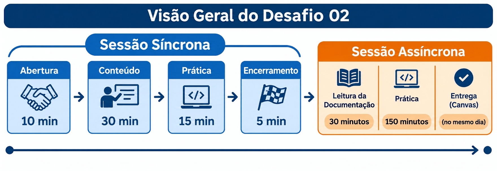

# Guia do Desafio 02 · Analista de Dados

**Parte 1 de 3 — Preparação e conteúdo da sessão**

<table width="100%">
  <tr>
    <td align="left" width="33%"><strong>Início</strong></td>
    <td align="center" width="34%"><a href="../README.md">README</a></td>
    <td align="right" width="33%"><a href="02.md">Avançar → Parte 2</a></td>
  </tr>
</table>

---

## 1. Como usar este guia

Este guia conduz você da base de dados do Desafio 1 até um **relatório de estatística básica com insights**, feito em Python (pandas) no Google Colab. O relatório calcula medidas de **tendência central**, **dispersão** e **distribuição** e termina com uma **recomendação de decisão** apoiada em números.

Todo o cálculo é feito com o **pandas**, dentro do Colab. O relatório é o **próprio notebook**: tabelas, gráficos, frases de insight e recomendação ficam nele, e o notebook é entregue no GitHub.

| **Período**    | **Quando**                                                                                       | **O que é**                                                                                                                                                                                                          |
| -------------- | ------------------------------------------------------------------------------------------------ | -------------------------------------------------------------------------------------------------------------------------------------------------------------------------------------------------------------------- |
| **SÍNCRONO**   | Durante a sessão com o Instrutor (60 min)                                                        | - Carregar os arquivos CSV do tema em DataFrames - Conferir a base antes de calcular - Calcular média, mediana e desvio padrão de uma coluna numérica - Escrever uma frase de insight para cada medida |
| **ASSÍNCRONO** | Depois da sessão, dentro das salas simultâneas separadas por tema: 150 a 180 minutos (2h30 a 3h) | - Ampliar a análise (grupos, outliers, distribuição) - Escrever a recomendação de decisão com pelo menos duas medidas - Gráficos (diferencial) - Entregar o notebook no GitHub                        |

 

> [!IMPORTANT]
>
> ### Base de dados
>
> **A base de dados utilizada neste desafio deve ser a base disponível no repositório do GitHub.** Não utilize a base de dados gerada no Desafio 01.
>
> O tema escolhido no Desafio 01 permanece o mesmo: **não troque de tema**. Utilize os **arquivos CSV correspondentes ao seu tema**, disponibilizados no repositório do GitHub.

 

> [!NOTE]
>
> ### O exemplo de referência: Biblioteca
>
> Na construção deste guia, utilizamos o tema **Biblioteca Pública**, que **não faz parte dos 8 temas disponíveis no desafio**. Ele foi escolhido apenas como exemplo didático para demonstrar como as tabelas são organizadas e como o notebook deve ser estruturado.
>
> | **Tabela**           | **Arquivo**       | **O que guarda**                                                                                  |
> | -------------------- | ----------------- | ------------------------------------------------------------------------------------------------- |
> | Dimensão (`livros`)  | `livros.csv`      | Acervo: título, autor, gênero, ano de publicação, número de páginas, idioma, filial e conservação |
> | Fato (`emprestimos`) | `emprestimos.csv` | Cada empréstimo: livro, leitor, datas, renovações, dias de atraso, multa, canal e status          |
>
> A chave estrangeira é `livro_id`: cada empréstimo aponta para um livro do acervo.
>
> **O guia não traz respostas**, nem do tema Biblioteca nem dos 8 temas: a pergunta de negócio, a coluna analisada, as leituras e as decisões saem dos dados do **seu** tema. O guia indica **o que usar** em cada passo.

 

---

## 2. O que você será capaz de fazer

- Reconhecer, na base do seu tema, a **tabela dimensão**, a **tabela fato**, as **chaves primárias** e a **chave estrangeira**.

- Carregar e organizar a base do seu tema em DataFrames pandas.

- Calcular medidas de tendência central e de dispersão com o pandas.

- Juntar as duas tabelas pela chave estrangeira para comparar grupos.

- Interpretar uma medida estatística como **insight de negócio**, não como número solto.

- Redigir uma recomendação de decisão apoiada em pelo menos duas medidas estatísticas.

- Produzir, como diferencial, gráficos com seaborn e matplotlib.

---

## 3. Mapa dos passos

| **Passo** | **O que você faz**                                              | **Quando**        | **Tempo sugerido** |
| --------- | --------------------------------------------------------------- | ----------------- | ------------------ |
| 1         | Definir a pergunta de negócio e a coluna de análise             | Sessão Síncrona   | durante o conteúdo |
| 2         | Preparar o ambiente: importar as bibliotecas                    | Sessão Síncrona   | durante o conteúdo |
| 3         | Obter os dados: carregar os 2 CSV e conhecer as tabelas         | Sessão Síncrona   | durante o conteúdo |
| 4         | Checar a base antes de calcular                                 | Sessão Síncrona   | durante o conteúdo |
| 5         | Calcular tendência central e dispersão                          | Sessão Síncrona   | 5 min (prática)    |
| 6         | Escrever as frases de insight                                   | Sessão Síncrona   | 6 min (prática)    |
| 7         | Ampliar a análise: comparar grupos                              | Sessão Assíncrona | 40 min             |
| 8         | Tratar valores ausentes e outliers, e registrar a decisão       | Sessão Assíncrona | 25 min             |
| 9         | Ler a distribuição dos valores                                  | Sessão Assíncrona | 20 min             |
| 10        | Redigir a recomendação de decisão (2 medidas ou mais)           | Sessão Assíncrona | 25 min             |
| 11        | Gráficos simples e legíveis (diferencial)                       | Sessão Assíncrona | 25 min             |
| 12        | Registrar o uso de IA e entregar no Canvas o link do GitHub     | Sessão Assíncrona | 25 min             |

Os tempos do trabalho assíncrono somam **160 minutos**, dentro da faixa de 150 a 180 minutos prevista. São uma referência, não um limite.

---

## 4. Google Colab

O código Python será construído no Google Colab, em **um único notebook**, dividido em duas partes. Não há nada para instalar: o Colab já traz o pandas, o seaborn e o matplotlib. O notebook também usa o **Google Drive**, onde os arquivos CSV ficam guardados.

| **Parte**                               | **Células** | **Quando**                        | **O que cobre**                                              |
| --------------------------------------- | ----------- | --------------------------------- | ------------------------------------------------------------ |
| **Parte 1 — Carga e primeiras medidas** | 01 a 10     | Sessão Síncrona (passos 2 a 6)    | Ambiente (01), dados (02 a 04), conferência da base (05 a 08), medidas estatísticas (09 e 10). As frases de insight (Passo 6) são texto |
| **Parte 2 — Análise completa**          | 11 a 20     | Sessão Assíncrona (passos 7 a 11) | Junção e grupos (11 a 13), outliers (14 e 15), distribuição (16 a 18), gráficos (19 e 20). A recomendação (Passo 10) é texto |

 

### Por onde começar?

Crie um novo notebook chamado **Desafio2_Estatistica_Python**, através da opção **Arquivo → Novo notebook**.

Além das **20 células de código**, o notebook também terá **11 células de texto que devem ser preenchidas por você**. Essas células são fundamentais, pois apresentam suas análises e interpretações e são **a primeira parte avaliada pelo instrutor**.

| **Passo** | **Célula de texto**                                              |
| --------- | ---------------------------------------------------------------- |
| 1         | Pergunta de negócio, coluna de análise e decisão que apoiaria    |
| 4         | Leitura da conferência                                           |
| 6         | Frases de insight                                                |
| 7         | Leitura de cada comparação entre grupos                          |
| 8         | Leitura e decisão registrada (outliers e valores ausentes)       |
| 9         | Leitura da distribuição                                          |
| 10        | Recomendação                                                     |
| 11        | Frase de leitura dos gráficos                                    |

---

## 5. O que você precisa ter em mãos

- Os **2 arquivos CSV do seu tema**, baixados do repositório do GitHub do Desafio.
- A **documentação do seu tema**, com o esquema de colunas, para conferir o tipo de cada coluna e identificar a chave estrangeira.
- Uma conta Google, para usar o **Google Colab** e o **Google Drive**.

---

# Sessão Síncrona - Resumo

## Bloco 1 — Base de dados

### As duas tabelas da base

A base de cada tema tem **duas tabelas ligadas entre si**. Entender o papel de cada uma é o que permite, mais adiante, juntar as duas e comparar grupos.

| **Conceito**              | **O que é**                                                                                                                                         | **Na Biblioteca**                                                  |
| ------------------------- | --------------------------------------------------------------------------------------------------------------------------------------------------- | ------------------------------------------------------------------ |
| **Tabela dimensão**       | O **cadastro**: descreve as "coisas" do tema. Cada linha é um item único e as colunas são as características dele                                   | `livros`: cada linha é um livro do acervo                          |
| **Tabela fato**           | O **registro de eventos**: cada linha é uma ocorrência e traz datas, quantidades e valores medidos. É onde ficam as colunas numéricas que se analisam | `emprestimos`: cada linha é um empréstimo                          |
| **Chave primária (PK)**   | A coluna que **identifica cada linha de forma única**: não se repete e não fica vazia. Toda tabela tem a sua                                        | `livro_id` em `livros` e `emprestimo_id` em `emprestimos`          |
| **Chave estrangeira (FK)** | A coluna da tabela fato que **guarda a chave primária de uma linha da dimensão**. É ela que liga cada evento ao seu cadastro                      | `livro_id` em `emprestimos` aponta para `livro_id` em `livros`     |

As colunas das duas tabelas da Biblioteca:

| **Tabela**               | **Colunas**                                                                                                                                                                                                                                |
| ------------------------ | ------------------------------------------------------------------------------------------------------------------------------------------------------------------------------------------------------------------------------------------ |
| `livros` (dimensão)      | `livro_id` (PK), `titulo`, `autor`, `genero`, `ano_publicacao`, `numero_paginas`, `idioma`, `filial`, `estado_conservacao`                                                                                                                 |
| `emprestimos` (fato)     | `emprestimo_id` (PK), `livro_id` (FK), `leitor_id`, `tipo_leitor`, `data_emprestimo`, `modalidade`, `renovacoes`, `data_devolucao_prevista`, `data_devolucao`, `dias_atraso`, `multa_reais`, `canal_retirada`, `status`                      |

> [!NOTE]
>
> `leitor_id` é apenas um número: **não existe uma tabela de leitores**, então ele não é chave estrangeira. Só é chave estrangeira a coluna que aponta para a chave primária de outra tabela da base.

 

✅**Exemplo:**

**Tabela dimensão `livros`**

| `livro_id` (PK) | `titulo` |
| --------------- | -------- |
| 1               | Livro A  |
| 2               | Livro B  |
| 3               | Livro C  |

**Tabela fato `emprestimos`**

| `emprestimo_id` (PK) | `livro_id` (FK) | `data_emprestimo` |
| -------------------- | --------------- | ----------------- |
| 1                    | 2               | 2025-03-10        |
| 2                    | 2               | 2025-03-12        |
| 3                    | 1               | 2025-03-12        |

O `Livro B` (`livro_id` 2) aparece em **dois empréstimos**: uma linha da dimensão pode estar ligada a **várias linhas da fato**. Já cada empréstimo aponta para **um único livro**.

 

**Por que isso importa para a análise**

- A tabela **fato** tem as colunas numéricas que você vai calcular (médias, desvios, percentis).
- A tabela **dimensão** traz as categorias para **comparar grupos** (Passo 7). Para usá-las, você junta as duas tabelas pela chave estrangeira.
- Antes de juntar, é preciso confirmar que **toda chave estrangeira aponta para uma chave primária que existe** na dimensão (Passo 4).

> [!TIP]
>
> ### Faça no seu tema
>
> Na documentação do seu tema, localize:
>
> 1. Qual arquivo é a **tabela dimensão** e qual é a **tabela fato**.
> 2. A **chave primária** de cada tabela.
> 3. A **chave estrangeira** da tabela fato e a chave primária da dimensão a que ela aponta. Você vai usar as duas no Passo 4.

 

### Carregar e conferir a base

Antes de calcular qualquer estatística, é preciso trazer os arquivos CSV para **DataFrames** e confirmar que estão limpos: coluna com o tipo certo, sem duplicata óbvia e sem valor ausente inesperado.

| **Verificação**                    | **Célula** | **Comando**                                                     | **O que você procura**                                                    |
| ---------------------------------- | ---------- | --------------------------------------------------------------- | ------------------------------------------------------------------------- |
| Tipo de cada coluna                | 05         | `df_fato.info()`                                                | Número como número e data como texto, conforme o esquema do tema          |
| Valores ausentes                   | 06         | `df_fato.isna().sum()`                                          | Colunas com valor faltando, antes de qualquer média                       |
| Linhas duplicadas                  | 07         | `df_fato.duplicated().sum()`                                    | Registros repetidos                                                       |
| Chave estrangeira entre as tabelas | 08         | `df_fato[COLUNA_FK].isin(df_dimensao[COLUNA_ID]).all()`         | `True`: todo registro da fato aponta para um cadastro que existe          |

> [!WARNING]
>
> Pular essa etapa é a causa mais comum de estatística errada. Uma média calculada com valor ausente ou absurdo não tratado fica distorcida e o Python **não acusa nenhum erro**.

 

> [!NOTE]
>
> ### Valor ausente nem sempre é erro
>
> Imagine uma tabela de pedidos com a coluna `nota_avaliacao`, vazia para os clientes que ainda não avaliaram. Não é defeito. A pergunta certa é: **por que está vazio?** Só depois você decide se ignora, preenche ou remove.

 

---

## Bloco 2 — Estatística descritiva: Medidas de Tendência central e Dispersão

**Tendência central** diz *onde os dados se concentram*. 

**Dispersão** diz *o quanto eles variam*. As duas juntas contam a história completa; uma sozinha engana.

| **Medida**    | **O que mostra**                          | **Cuidado**                                                 | **pandas**                                  |
| ------------- | ----------------------------------------- | ----------------------------------------------------------- | ------------------------------------------- |
| Média         | Soma dividida pela quantidade             | Sensível a valor extremo (outlier)                          | `serie_numerica.mean()`                     |
| Mediana       | O valor do meio                           | Não se move com outlier; boa para dado assimétrico          | `serie_numerica.median()`                   |
| Moda          | O valor mais frequente                    | Útil para dado categórico, não só numérico                  | `serie_numerica.mode()`                     |
| Desvio padrão | O quanto os valores se afastam da média   | Está na mesma unidade da coluna                             | `serie_numerica.std()`                      |
| Variância     | O desvio padrão elevado ao quadrado       | Está na unidade ao quadrado, por isso é mais difícil de ler | `serie_numerica.var()`                      |
| Amplitude     | Distância entre o maior e o menor valor   | Simples, mas sensível a outlier                             | `serie_numerica.max() - serie_numerica.min()` |

---

## Bloco 3 — Do número ao insight: apoiando uma decisão

O relatório só tem valor se alguém conseguir **decidir algo** a partir dele. Um número sem recomendação é dado; um número com recomendação é **insight**.

Todo insight tem três partes, e a primeira é sempre o número:

| **Parte**   | **Pergunta que responde**         | **Como escrever**                                                    |
| ----------- | --------------------------------- | -------------------------------------------------------------------- |
| **Medida**  | Qual número sustenta a conclusão? | Cite a medida, a coluna e o valor                                    |
| **Leitura** | O que esse número significa?      | Compare com outra medida (por exemplo, média e mediana)              |
| **Decisão** | O que fazer a respeito?           | Diga uma ação possível, em linguagem que alguém de fora entenderia   |

Um exemplo com a lanchonete fictícia do Bloco 2 (apenas para mostrar o formato):

> **Medida:** a média das compras é de R$ 33,33, a mediana é de R$ 16,50 e o desvio padrão é de R$ 42,48.
> **Leitura:** a compra típica é bem menor que a média, e uma única compra muito alta puxa o resultado para cima.
> **Decisão:** planejar o estoque pelo valor da mediana e analisar à parte as compras muito altas.

- Todo insight cita a medida que o sustenta: **não existe insight sem número por trás**.

- Escreva a recomendação em **uma frase** que alguém de fora da área entenderia.

- Os gráficos (seaborn, matplotlib ou plotly) são **diferencial**: só entram depois que o relatório estiver completo em texto e tabela.

- Um gráfico simples e legível vale mais que um gráfico bonito e confuso. Todo gráfico precisa de **título** e **eixos identificados**.

> [!IMPORTANT]
>
> O instrutor avalia primeiro a **qualidade da interpretação estatística em texto**. Os gráficos somam pontos, mas não substituem a análise.

 

---

<table width="100%">
  <tr>
    <td align="left" width="33%"><strong>Início</strong></td>
    <td align="center" width="34%"><a href="../README.md">README</a></td>
    <td align="right" width="33%"><a href="02.md">Avançar → Parte 2</a></td>
  </tr>
</table>
